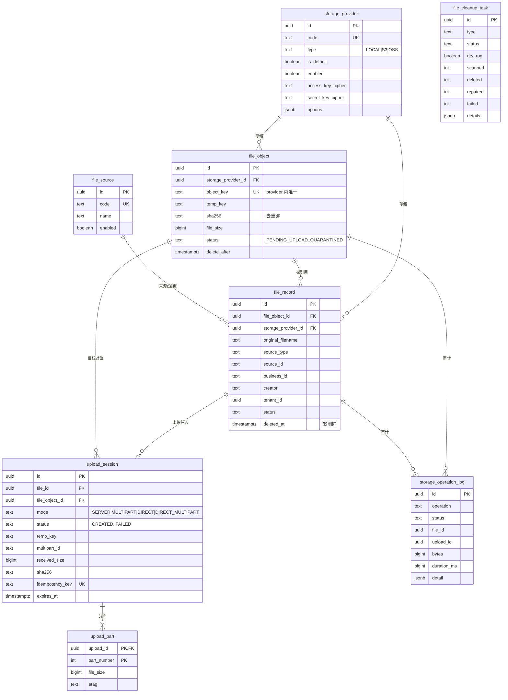

# 通用文件系统服务（file-service）

生产级通用文件系统服务，为平台内所有业务模块提供统一的文件上传、存储、下载、去重与清理能力。服务通过可插拔的 `StorageProvider` 抽象同时支持本地磁盘、Amazon S3 与阿里云 OSS，并在数据库层面管理多个存储实例。

- 技术栈：Java 25、Spring Boot 4.1、Spring MVC、Spring Security、Spring JDBC、PostgreSQL、Flyway、Jackson、springdoc-openapi、Micrometer + OpenTelemetry、JUnit 5、Testcontainers
- 架构：模块化单体，分为 `bootstrap / interfaces / application / domain / infrastructure / shared`
- 运行方式：单进程，无状态（除本地存储目录），可直接水平扩容，定时任务通过数据库任务锁互斥

## 功能特性

| 能力 | 说明 |
| --- | --- |
| 多存储实例 | 数据库管理多个存储实例，支持启用/禁用、默认存储、连接测试、上传/下载/删除开关 |
| 凭据安全 | AccessKey / SecretKey 使用 AES-256-GCM 加密后落库，接口不回显明文；支持环境变量注入 |
| 上传模式 | 服务端上传、服务端分片上传、客户端直传（预签名 URL）、客户端分片直传（分片授权） |
| 上传生命周期 | 创建、上传、完成、确认、取消、超时过期、中断恢复、幂等键 |
| 临时/永久隔离 | 上传期间写入 `temporary/`，确认后复制到 `permanent/yyyy/MM/{objectId}/` 并删除临时对象 |
| 内容去重 | 基于 SHA-256；`fileId` 与 `contentHash` 分离；唯一索引保证并发去重；一个物理对象可被多条记录引用 |
| 引用计数 | 删除记录不立即删物理文件；引用数为 0 后进入 `PENDING_DELETE`，延迟回收 |
| 直传安全 | 授权不等于成功；确认时通过 HEAD + 服务端重新计算哈希校验真实写入 |
| 运维能力 | 孤儿清理、物理删除、双向一致性检查、Dry Run、分页扫描、任务互斥、失败重试、操作审计 |
| 安全防护 | 扩展名白名单、MIME 白名单、内容嗅探、文件名清洗、路径穿越防护、随机对象 Key |
| 可观测性 | Micrometer 指标、Prometheus/OTLP、结构化日志（traceId/uploadId/fileId/fileObjectId/storageProviderId/operation） |

## 目录结构

```
backend/business_foundation/file
├── Dockerfile
├── docker-compose.yml
├── .env.example
├── pom.xml
└── src
    ├── main
    │   ├── java/com/platform/file
    │   │   ├── FileApplication.java              # bootstrap
    │   │   ├── config/                           # 配置、安全、OpenAPI、Trace
    │   │   ├── interfaces/                       # REST 控制器与请求 DTO
    │   │   ├── application/                      # 上传/文件/来源/存储/清理服务、视图映射、定时任务
    │   │   ├── domain/                           # 模型、仓储接口、存储抽象
    │   │   ├── infrastructure/                   # JDBC 仓储、存储适配器、加密、令牌、指标
    │   │   └── shared/                           # Api/异常/工具/校验
    │   └── resources
    │       ├── application.yml                   # 默认配置
    │       ├── application-dev.yml
    │       ├── application-test.yml
    │       ├── application-prod.yml
    │       └── db/migration/V1__init.sql         # Flyway 初始化脚本
    └── test/java/com/platform/file               # 单元测试 + Testcontainers 集成测试
```

## 快速开始

### 方式一：Docker Compose（推荐）

```bash
cp .env.example .env        # 按需修改
docker compose up -d --build
```

启动后：

- 服务地址：http://localhost:8082
- 健康检查：`GET /health`、`GET /live`、`GET /ready`
- OpenAPI：http://localhost:8082/v3/api-docs
- Swagger UI：http://localhost:8082/docs
- MinIO 控制台：http://localhost:9001（默认 `minioadmin/minioadmin`）

Compose 会启动 PostgreSQL、MinIO、一次性建桶任务 `minio-init` 以及文件服务本身。MinIO 桶名默认为 `file-bucket`。如需使用 MinIO 作为存储后端，启动后调用存储管理接口创建 S3 类型存储实例：

```bash
curl -X POST http://localhost:8082/api/v1/storage-providers \
  -H "Content-Type: application/json" \
  -H "X-API-Key: dev-file-api-key-change-me" \
  -d '{
    "code": "minio",
    "name": "MinIO",
    "type": "S3",
    "endpoint": "http://minio:9000",
    "region": "us-east-1",
    "bucket": "file-bucket",
    "root_path": "platform",
    "access_key": "minioadmin",
    "secret_key": "minioadmin",
    "options": {"path_style_access": true},
    "enabled": true
  }'
```

### 方式二：本地运行

前置条件：JDK 25、Maven 3.9+、PostgreSQL 16。

```bash
export FILE_DATABASE_URL=jdbc:postgresql://localhost:5432/file_service
export FILE_DATABASE_USER=file_service
export FILE_DATABASE_PASSWORD=file_service
mvn spring-boot:run
```

Flyway 会在启动时自动建表；首启会 Seed 一个默认本地存储实例 `local-default`（根目录 `./data/storage`）以及常用来源类型（USER/ORDER/PRODUCT/ADMIN/CONTENT/SYSTEM）。

## 配置说明

所有配置均支持环境变量覆盖，完整列表见 [application.yml](src/main/resources/application.yml)。

| 环境变量 | 默认值 | 说明 |
| --- | --- | --- |
| `FILE_PORT` | `8082` | HTTP 端口 |
| `FILE_PUBLIC_BASE_URL` | `http://localhost:8082` | 对外基地址，用于拼接本地下载链接 |
| `CORS` | `*` | 允许的跨域来源 |
| `FILE_API_KEY` | 空 | 管理接口 API Key；为空时开发模式放行，生产必须配置 |
| `FILE_DATABASE_URL` | `jdbc:postgresql://localhost:5432/file_service` | JDBC 连接串 |
| `FILE_DATABASE_USER` / `FILE_DATABASE_PASSWORD` | `file_service` | 数据库账号 |
| `FILE_DB_POOL_SIZE` | `16` | Hikari 最大连接数 |
| `FILE_FLYWAY_ENABLED` | `true` | 是否执行数据库迁移 |
| `FILE_MAX_FILE_SIZE` | `5368709120` | 单文件大小上限（字节） |
| `FILE_ALLOWED_EXTENSIONS` | 图片/文档/音视频等白名单 | 允许的扩展名（逗号分隔） |
| `FILE_ALLOWED_MIME_TYPES` | 与扩展名对应的 MIME 前缀 | 允许的 MIME 类型 |
| `FILE_SNIFF_CONTENT` | `true` | 是否进行内容嗅探校验 |
| `FILE_LOCAL_ROOT` | `./data/storage` | 本地存储根目录 |
| `FILE_TEMP_PREFIX` | `temporary/` | 临时对象前缀 |
| `FILE_PERMANENT_PREFIX` | `permanent/` | 永久对象前缀 |
| `FILE_UPLOAD_WORK_DIR` | `./data/upload-tmp` | 服务端上传临时工作目录 |
| `FILE_UPLOAD_EXPIRY_SECONDS` | `3600` | 上传会话有效期 |
| `FILE_UPLOAD_MIN_PART_SIZE` | `5242880` | 分片最小大小 |
| `FILE_UPLOAD_MAX_PART_SIZE` | `104857600` | 分片最大大小 |
| `FILE_UPLOAD_MAX_PARTS` | `1000` | 单次上传最大分片数 |
| `FILE_CONFIRM_TIMEOUT_MINUTES` | `30` | 确认阶段超时时间，超时由一致性检查置为失败 |
| `FILE_DOWNLOAD_URL_TTL` | `300` | 下载链接有效期（秒） |
| `FILE_DOWNLOAD_SECRET` | 空 | 本地下载令牌 HMAC 密钥；为空时由加密密钥派生 |
| `FILE_CLEANUP_ENABLED` | `true` | 是否启用定时清理任务 |
| `FILE_CLEANUP_DRY_RUN` | `false` | 全局 Dry Run 开关 |
| `FILE_ORPHAN_SAFETY_MINUTES` | `1440` | 孤儿扫描安全期，期间内的对象不处理 |
| `FILE_DELETE_GRACE_MINUTES` | `10` | 引用归零后的延迟回收时间 |
| `FILE_CLEANUP_BATCH_SIZE` | `200` | 单批处理数量 |
| `FILE_CLEANUP_MAX_PER_RUN` | `1000` | 单次任务最大处理数量 |
| `FILE_CLEANUP_LOCK_SECONDS` | `900` | 任务锁持有时间 |
| `FILE_ENCRYPTION_KEY` | 开发默认值 | Base64 编码的 32 字节 AES 密钥，生产必须替换 |
| `FILE_SEED_ENABLED` | `true` | 是否执行启动 Seed |

> 生产环境必须替换 `FILE_ENCRYPTION_KEY` 与 `FILE_API_KEY`，并通过密钥管理系统注入，不要写入代码仓库。

## 数据模型



去重依赖部分唯一索引：

```sql
CREATE UNIQUE INDEX file_object_sha_uq
    ON file_object (storage_provider_id, sha256)
    WHERE sha256 IS NOT NULL AND status IN ('ACTIVE', 'MIGRATING', 'PENDING_DELETE');
```

并发上传相同内容时，由数据库唯一约束裁决，未命中的一方复用已存在对象并删除自己的临时副本。

## 核心流程

### 上传状态机

```
CREATED ──上传内容──> UPLOADING ──全部完成──> UPLOADED ──确认──> CONFIRMING ──> CONFIRMED
   │                     │                        │
   ├──取消──────────────> CANCELLED               ├──校验失败──> FAILED
   └──超时──────────────> EXPIRED                 └──超时──────> EXPIRED
```

对象状态：`PENDING_UPLOAD → TEMP_UPLOADED → MIGRATING → ACTIVE → PENDING_DELETE → DELETED`，异常分支为 `FAILED / QUARANTINED`。

### 确认与去重

1. 读取临时对象，校验大小、MIME、SHA-256（服务端重新计算，不信任客户端）。
2. 在同一存储实例内按 SHA-256 查找可复用对象；命中则复用并删除本次临时对象（`file.dedup.hit` +1）。
3. 未命中则 `copy` 到永久 Key，事务内激活 `file_object` 与 `file_record`。
4. 清理临时对象；失败由一致性检查兜底修复。

### 清理与回收

| 任务 | 触发 | 行为 |
| --- | --- | --- |
| 上传过期 | 每 45s | 将超过 `expires_at` 的会话置为 `EXPIRED`，标记对象与记录 |
| 物理删除 | 每 60s | 处理 `PENDING_DELETE` 且 `delete_after` 到期的对象，复核引用数后删除存储对象 |
| 孤儿扫描 | 每 120s | 分页列出 `permanent/` 下对象，安全期外且无数据库记录的删除（支持 Dry Run） |
| 一致性检查 | 每 180s | 双向校验数据库与存储：缺失对象置 `QUARANTINED`、残留 `DELETED` 对象补删、卡住的 `MIGRATING` 置失败、超时 `PENDING` 记录置 `EXPIRED` |

所有任务通过 `job_lock` 表互斥，执行结果写入 `file_cleanup_task`。

## REST API

统一响应：

```json
{"code": "ok", "data": { ... }}
```

分页响应：`data = {items, total, page, size}`。错误响应返回对应 HTTP 状态码与 `{code, message, details}`。

除 `/api/v1/public/**` 与健康检查外，均需认证。当配置了 `FILE_API_KEY` 时，请求需携带 `X-API-Key`。

### 存储管理

| 方法 | 路径 | 说明 |
| --- | --- | --- |
| POST | `/api/v1/storage-providers` | 创建存储实例 |
| GET | `/api/v1/storage-providers` | 列表（`enabled`、`type` 过滤） |
| GET | `/api/v1/storage-providers/{id}` | 详情（不返回明文密钥） |
| PATCH | `/api/v1/storage-providers/{id}` | 更新配置 |
| DELETE | `/api/v1/storage-providers/{id}` | 删除实例（存在文件时拒绝） |
| POST | `/api/v1/storage-providers/{id}/test` | 连接测试 |
| POST | `/api/v1/storage-providers/{id}/default` | 设为默认 |
| POST | `/api/v1/storage-providers/{id}/enabled` | 启用/禁用 |

### 上传管理（服务端）

| 方法 | 路径 | 说明 |
| --- | --- | --- |
| POST | `/api/v1/uploads` | 创建上传任务（`mode=SERVER` 或 `MULTIPART`） |
| POST | `/api/v1/uploads/{uploadId}/content` | 上传内容，支持 `multipart/form-data` 与 `application/octet-stream` |
| POST | `/api/v1/uploads/{uploadId}/parts/{partNumber}` | 上传指定分片 |
| POST | `/api/v1/uploads/{uploadId}/complete-multipart` | 合并分片 |
| POST | `/api/v1/uploads/{uploadId}/confirm` | 确认并迁移到永久存储 |
| GET | `/api/v1/uploads/{uploadId}` | 上传详情 |
| POST | `/api/v1/uploads/{uploadId}/cancel` | 取消并清理临时对象 |

创建请求示例：

```json
{
  "storage_provider_id": "0192f0a1-...",
  "filename": "report.pdf",
  "display_name": "季度报告",
  "content_type": "application/pdf",
  "size": 1048576,
  "source_type": "USER",
  "source_id": "avatar",
  "business_id": "order-1001",
  "creator": "u-1001",
  "tenant_id": "0192f0a1-...",
  "metadata": {"scene": "order"},
  "idempotency_key": "client-generated-uuid",
  "mode": "MULTIPART",
  "part_size": 5242880
}
```

### 客户端直传

| 方法 | 路径 | 说明 |
| --- | --- | --- |
| POST | `/api/v1/direct-uploads` | 创建直传任务，返回预签名上传授权（`mode=DIRECT` 或 `DIRECT_MULTIPART`） |
| POST | `/api/v1/direct-uploads/{uploadId}/parts/authorize` | 批量获取分片上传授权 |
| POST | `/api/v1/direct-uploads/{uploadId}/complete` | 客户端上传完成后回调，服务端 HEAD + 哈希校验 |
| GET | `/api/v1/direct-uploads/{uploadId}` | 直传详情 |
| POST | `/api/v1/direct-uploads/{uploadId}/cancel` | 取消 |

直传授权仅代表“允许写入该 Key”，不代表上传成功；必须调用 `complete` 与 `confirm` 后才会生成可下载文件。

### 文件管理

| 方法 | 路径 | 说明 |
| --- | --- | --- |
| GET | `/api/v1/files` | 查询（`status/source_type/source_id/business_id/storage_provider_id/creator/tenant_id/mime_type/filename/created_from/created_to/sort/page/size`） |
| GET | `/api/v1/files/{fileId}` | 文件详情 |
| GET | `/api/v1/files/by-source` | 按来源查询（`source_type` + `source_id`） |
| GET | `/api/v1/files/by-business` | 按业务查询（`business_id`） |
| POST | `/api/v1/files/batch-query` | 批量查询（`{"ids": [...]}`） |
| DELETE | `/api/v1/files/{fileId}` | 软删除记录，引用归零后延迟回收物理文件 |
| POST | `/api/v1/files/batch-delete` | 批量软删除 |
| PATCH | `/api/v1/files/{fileId}/status` | 状态管理（`ACTIVE/EXPIRED/QUARANTINED` 等） |
| GET | `/api/v1/files/{fileId}/download-url` | 获取下载地址（本地返回签名令牌 URL，S3/OSS 返回预签名 URL） |
| GET | `/api/v1/files/{fileId}/download-token` | 仅获取下载令牌 |
| GET | `/api/v1/files/stats` | 文件统计 |
| GET | `/api/v1/files/source-stats` | 来源维度统计 |
| GET | `/api/v1/public/files/{fileId}/content?token=...` | 公开下载入口（签名令牌校验） |

### 来源字典

| 方法 | 路径 | 说明 |
| --- | --- | --- |
| GET | `/api/v1/file-sources` | 列表 |
| GET | `/api/v1/file-sources/{id}` | 详情 |
| POST | `/api/v1/file-sources` | 创建（`code` 仅允许 `A-Za-z0-9_.-`） |
| PATCH | `/api/v1/file-sources/{id}` | 更新 |
| POST | `/api/v1/file-sources/{id}/enabled` | 启用/禁用 |
| DELETE | `/api/v1/file-sources/{id}` | 删除（被引用时拒绝） |

### 运维接口

| 方法 | 路径 | 说明 |
| --- | --- | --- |
| POST | `/api/v1/ops/scan?provider_id=&dry_run=` | 孤儿对象扫描 |
| POST | `/api/v1/ops/cleanup?provider_id=&dry_run=` | 立即执行物理删除回收 |
| POST | `/api/v1/ops/consistency?dry_run=` | 双向一致性检查 |
| POST | `/api/v1/ops/upload-expiry` | 立即处理过期上传 |
| GET | `/api/v1/ops/cleanup-tasks` | 清理任务列表（`type`、`status`、分页） |
| GET | `/api/v1/ops/cleanup-tasks/{id}` | 任务详情 |
| GET | `/api/v1/ops/summary` | 运维总览 |
| GET | `/api/v1/ops/operation-logs` | 操作日志（`operation`、`status`、`file_id`、分页） |
| GET | `/api/v1/ops/file-stats` | 文件统计 |
| GET | `/api/v1/ops/source-stats` | 来源统计 |
| GET | `/api/v1/ops/storage-usage` | 各存储实例用量 |

### 健康检查

| 方法 | 路径 | 说明 |
| --- | --- | --- |
| GET | `/health` | 服务存活信息 |
| GET | `/live` | 存活探针 |
| GET | `/ready`, `/readyz` | 就绪探针（含数据库连通性） |

## 安全设计

- **认证**：管理接口统一校验 `X-API-Key`（`ApiKeyFilter`），未配置时仅用于本地开发。
- **凭据加密**：`SecretCipher` 使用 AES-256-GCM，密文与 IV 一并存储；接口只返回 `access_key_env/secret_key_env` 等非敏感信息。
- **下载授权**：本地存储使用 HMAC-SHA256 签名令牌（含 `fileId` 与过期时间）；S3/OSS 使用预签名 URL，有效期默认 300 秒。
- **文件校验**：扩展名白名单 + MIME 白名单 + 内容嗅探；文件名清洗并去除路径分隔符；对象 Key 使用随机 UUID，避免路径穿越与可预测访问。
- **审计**：所有存储操作写入 `storage_operation_log`，包含耗时、字节数、traceId、错误信息。

## 可观测性

指标（`/actuator/metrics`、`/actuator/prometheus`）：

- `file.upload.success` / `file.upload.failure`
- `file.upload.duration`
- `file.download.count` / `file.download.duration`
- `file.dedup.hit`
- `file.cleanup.success` / `file.cleanup.failure`
- `file.storage.connection.failure`
- `file.count` / `file.size.bytes` / `file.temporary.count` / `file.orphan.count`
- `file.provider.usage.bytes` / `file.provider.file.count`（按 provider 标签）

日志为单行结构化格式，MDC 包含 `traceId`、`uploadId`、`fileId`、`fileObjectId`、`storageProviderId`、`operation`，可直接接入 OTLP 链路追踪。

## 测试

```bash
# 单元测试（不需要 Docker）
mvn test

# 集成测试（Testcontainers：PostgreSQL；MinIO 用例需要本地可拉取 minio/minio 镜像）
mvn -Pintegration test

# 仅运行 S3 直传集成测试
mvn -Pintegration -Dtest=S3DirectUploadIntegrationTest test

# 指定其它 MinIO 镜像
mvn -Pintegration -Dtest=S3DirectUploadIntegrationTest -Dfile.it.minio-image=minio/minio:latest test
```

覆盖场景包括：服务端上传与下载、分片合并、SHA-256 去重、删除与引用计数回收、取消与过期、直传拒绝本地存储、孤儿扫描 Dry Run 与真实删除、一致性检查隔离缺失对象、清理任务与来源统计、S3 预签名直传与分片直传、路径穿越防护、令牌篡改与过期等。

## 部署说明

- 单实例可运行；多实例部署时清理任务通过 `job_lock` 互斥，无需额外协调组件。
- 数据库需 PostgreSQL 14+，Flyway 自动迁移；升级前建议先备份。
- 本地存储需为服务进程准备可写卷（Compose 中挂在 `/app/data`）；生产建议使用 S3/OSS。
- 容器以非 root（UID 10001）运行，`JAVA_OPTS` 默认 `-XX:MaxRAMPercentage=75`。
- 反向代理需透传 `X-Forwarded-*`（`FILE_TRUST_PROXY=true` 时会读取客户端 IP）。
- 预签名 URL 的生成基于服务端配置的 `endpoint`，必须与客户端可达的地址一致。

## 扩展新的存储后端

1. 实现 `com.platform.file.domain.storage.StorageProvider`。
2. 在 `StorageProviderRegistry` 中注册新类型（MinIO/R2 建议复用 S3 适配器，仅调整 `endpoint`，MinIO/R2 默认开启 path-style）。
3. 在 `StorageType` 与 `storage_provider.type` 约束中加入新枚举值并新增 Flyway 迁移。
4. 补充 `PresignProvidersTest` 风格的签名测试与 Testcontainers 集成测试。
