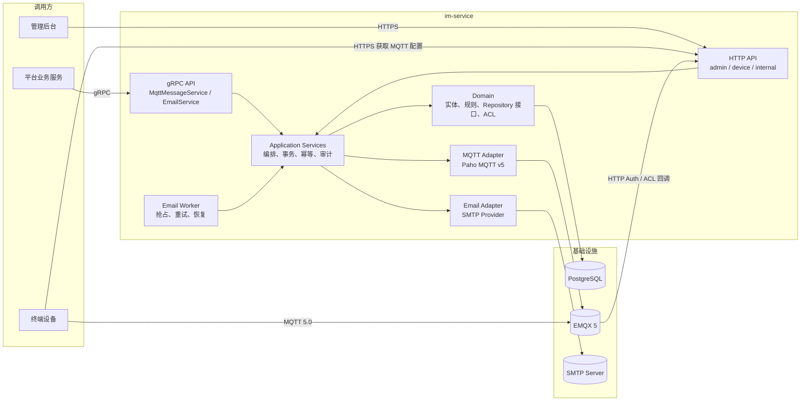
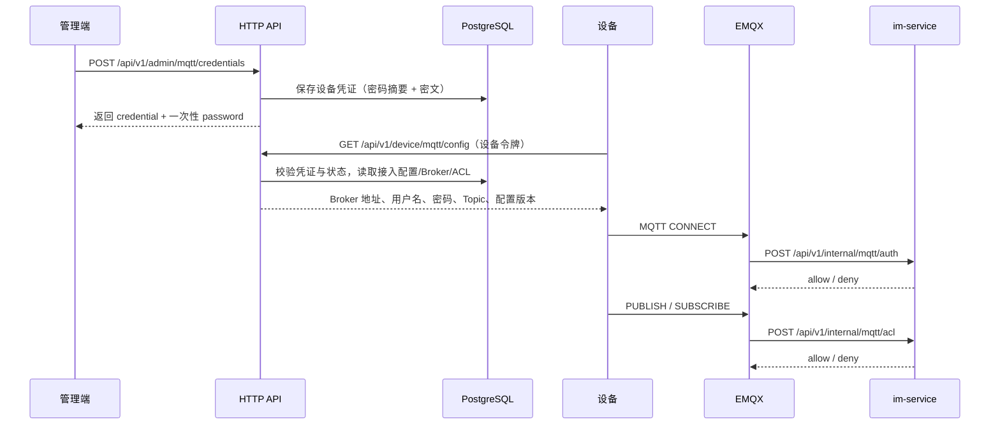
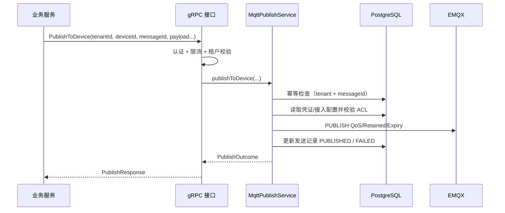
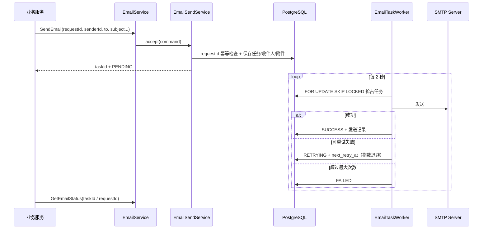

# 架构设计

## 1. 总体架构

im-service 采用模块化单体：一个可部署的 Spring Boot 应用，内部按领域与技术职责分层。MQTT 与邮件模块只通过应用服务与领域接口交互，未来可独立拆分。

## 2. 分层与模块

| 层 | 包 | 职责 |
| --- | --- | --- |
| Web | `web.admin` / `web.device` / `web.internal` | HTTP Controller，只做参数绑定、校验与响应封装 |
| gRPC | `grpc` | Protobuf 服务实现、认证/指标拦截器、错误映射 |
| Application | `application` | 业务编排、事务边界、幂等、限流、任务调度 |
| Domain | `domain` | 实体、枚举、领域规则（`TopicRules`）、Repository 接口 |
| Infrastructure | `infrastructure` | Paho MQTT、SMTP 邮件、限流器等外部适配器 |
| Security | `security` | API Key / JWT / 设备凭证认证、请求上下文 |
| Config | `config` | Spring 配置、过滤器、审计拦截器、初始化数据 |
| Shared | `shared` | 统一响应、错误码、异常、加密、分页、ID 工具 |

约束：

- Controller 不直接访问 Repository。
- MQTT / SMTP 配置全部来自数据库，不在业务代码中硬编码。
- 外部系统通过接口接入：`MqttPublisher`、`EmailProvider`。
- DTO / Entity / Domain Model 分离，Entity 不直接作为 HTTP 响应。

## 3. 核心业务流程

### 3.1 设备接入与 MQTT 配置下发

要点：

- 设备只能读取自己的配置，设备身份来自 `X-Device-Id + X-Device-Token` 或 JWT `device_id`。
- 设备 MQTT 用户名由服务生成，密码仅在创建/轮换时返回一次，数据库保存摘要与密文。
- Topic 由接入配置模板解析，ACL 按 `DEVICE + deviceId + action` 匹配，支持 `ALLOW` / `DENY` 与优先级。

### 3.2 平台服务通过 gRPC 发布 MQTT 消息

- Topic 由服务端根据接入配置推导，调用方不能任意指定（`PublishToTopic` 仅允许服务端 ACL 或前缀授权）。
- 批量发布对每个设备独立记录结果，单设备失败不影响其他设备。
- `messageId` + 租户唯一约束保证幂等；批量使用 `messageId#deviceId`。

### 3.3 邮件异步发送

- 抢占与状态更新在同一事务内完成，多实例部署时不会重复消费同一任务。
- Worker 每 60 秒恢复超时 `PROCESSING` 任务。
- 发送前校验发送方启用状态、配置完整性、分钟/日限额；限额触发时重新排队且不消耗重试次数。

## 4. 安全架构

| 场景 | 机制 |
| --- | --- |
| 管理 HTTP | `X-API-Key`（常量时间比较）或平台 JWT + 角色校验 |
| 内部回调 | `X-Internal-Token`，仅允许 `/api/v1/internal/**` |
| 设备 HTTP | 设备令牌摘要校验，或平台 JWT `device_id` |
| gRPC | JWT 或内部令牌，健康检查放行 |
| MQTT | EMQX HTTP 认证 + Topic ACL |
| 传输安全 | HTTPS（外部网关/反向代理）、gRPC TLS/mTLS、MQTT TLS |
| 敏感数据 | AES-256-GCM 加密、SHA-256 + pepper 摘要、日志脱敏 |
| 租户隔离 | 所有查询携带 `tenant_id`；JWT 租户与请求租户不一致直接拒绝 |
| 幂等 | `messageId` / `requestId` 唯一索引 |
| 限流 | HTTP 每分钟固定窗口、gRPC 每分钟固定窗口、邮件发送方分钟/日限额 |
| 审计 | 管理 API 自动写入 `operation_audit_log` |

## 5. 可观测性

- 统一日志格式包含 `traceId`、`tenantId`、`actor`；`TraceFilter` 接受或生成 `X-Trace-Id` 并回写响应头。
- Actuator 暴露 `health`、`info`、`metrics`、`prometheus`。
- 自定义指标见 README。
- MQTT 健康指示器聚合 Broker 连接状态。

## 6. 扩展点

| 扩展方向 | 方式 |
| --- | --- |
| 新 MQTT Broker | 实现 Broker 适配层；`BrokerType` 扩展，Paho 协议本身与厂商无关 |
| 新邮件供应商 | 实现 `EmailProvider` 并注册到 `EmailProviderRegistry` |
| 消息队列替换数据库任务表 | 将 `EmailTaskWorker` 的抢占来源替换为 MQ 消费者，保留 `EmailDeliveryService` |
| 拆分微服务 | MQTT 与邮件模块已通过 Application + Domain 边界隔离，可独立建库/部署 |
| 设备 ACK 确认 | 预留业务确认语义：MQTT QoS 只保证协议交付，不保证设备业务处理 |
