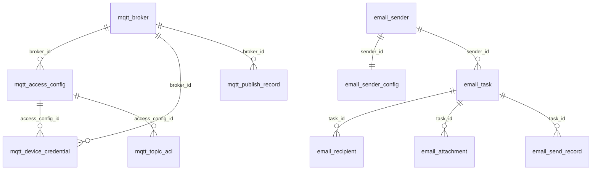

# 数据库设计

数据库：PostgreSQL 14+，DDL 由 Flyway 管理：

- 迁移目录：`src/main/resources/db/migration`
- 初始化脚本：[V1__init.sql](../src/main/resources/db/migration/V1__init.sql)
- `spring.jpa.hibernate.ddl-auto=none`，禁止 Hibernate 自动改表

所有表主键为 `UUID`，统一包含 `created_at` / `updated_at`（`TIMESTAMPTZ`，UTC）。敏感字段以 `*_cipher` 保存 AES-256-GCM 密文。

## 1. 表清单

### MQTT

| 表 | 说明 |
| --- | --- |
| `mqtt_broker` | Broker 连接配置、默认标记、运行状态、重连次数 |
| `mqtt_access_config` | 接入配置：Broker 绑定、Topic 模板、QoS、会话、TLS、认证模式、配置版本 |
| `mqtt_device_credential` | 设备 MQTT 凭证：用户名、密码摘要/密文、状态、版本、过期时间 |
| `mqtt_topic_acl` | Topic 权限：主体类型/ID、Topic 规则、动作、效果、QoS 上限、优先级 |
| `mqtt_publish_record` | 消息发送记录：幂等键、Topic、QoS、状态、错误、Trace ID |

### 邮件

| 表 | 说明 |
| --- | --- |
| `email_sender` | 发送方：编码、发件人、供应商类型、默认标记、限额、启停 |
| `email_sender_config` | SMTP 连接配置（与发送方 1:1），密码加密 |
| `email_task` | 邮件任务：requestId 幂等、状态、重试、锁定信息、正文 |
| `email_recipient` | 收件人：TO / CC / BCC |
| `email_attachment` | 附件元数据：文件名、类型、大小、存储路径、SHA-256 |
| `email_send_record` | 每次投递尝试的发送记录：状态、耗时、供应商返回、失败原因 |

### 通用

| 表 | 说明 |
| --- | --- |
| `operation_audit_log` | 管理操作审计：操作者、动作、路径、状态、IP、Trace ID、耗时 |

## 2. 关系



## 3. 关键约束与索引

| 约束/索引 | 作用 |
| --- | --- |
| `mqtt_broker_code_uq (lower(code))` | Broker 编码唯一（大小写不敏感） |
| `mqtt_broker_default_uq (is_default) WHERE is_default` | 全库仅一个默认 Broker |
| `mqtt_access_config_code_uq` / `_default_uq` | 接入配置编码唯一；每租户仅一个默认配置 |
| `mqtt_device_username_uq` | MQTT 用户名全局唯一 |
| `mqtt_device_tenant_device_uq` / `_global_device_uq` | 每租户设备唯一；全局租户设备唯一 |
| `mqtt_publish_message_uq (tenant, message_id)` | 发布幂等 |
| `mqtt_publish_tenant_idx` / `_device_idx` / `_status_idx` | 记录查询与失败排查 |
| `email_sender_code_uq` / `_default_uq` | 发送方编码唯一；每租户仅一个默认发送方 |
| `email_task_request_uq (tenant, request_id)` | 邮件受理幂等 |
| `email_task_queue_idx (status, next_retry_at, created_at)` | Worker 抢占队列 |
| `email_task_locked_idx (status, locked_at)` | 僵死任务恢复 |
| `email_recipient_task_idx` / `email_attachment_task_idx` / `email_send_record_task_idx` | 任务详情聚合 |
| `operation_audit_*_idx` | 审计按时间/租户/动作查询 |

## 4. 状态枚举

| 字段 | 取值 |
| --- | --- |
| `mqtt_broker.status` | `UNKNOWN` / `CONNECTED` / `DISCONNECTED` / `ERROR` |
| `mqtt_device_credential.status` | `ACTIVE` / `DISABLED` / `REVOKED` / `EXPIRED` |
| `mqtt_topic_acl.subject_type` | `DEVICE` / `SERVICE` |
| `mqtt_topic_acl.action` | `PUBLISH` / `SUBSCRIBE` |
| `mqtt_topic_acl.effect` | `ALLOW` / `DENY` |
| `mqtt_publish_record.status` | `PENDING` / `PUBLISHED` / `FAILED` |
| `email_task.status` | `PENDING` / `PROCESSING` / `SUCCESS` / `RETRYING` / `FAILED` |
| `email_recipient.recipient_type` | `TO` / `CC` / `BCC` |
| `email_send_record.status` | `SUCCESS` / `FAILED` |

## 5. 逻辑删除

`mqtt_access_config`、`mqtt_device_credential`、`email_sender` 使用 `deleted` 标记逻辑删除，查询默认过滤 `deleted = false`；唯一索引均带 `WHERE NOT deleted`，允许删除后重建同编码数据。

## 6. 数据增长与归档

- `mqtt_publish_record`、`email_send_record`、`operation_audit_log` 会持续增长，建议：
  - 按 `created_at` 做月度分区或定期归档到冷存储；
  - 保留常用查询窗口（如 90 天）后清理历史数据；
  - 归档前先导出并校验幂等键，避免重复消息重新入库。
- `email_task` 完成后可保留任务元数据，正文与附件按合规要求定期清理。
- 附件默认落盘到 `IM_EMAIL_ATTACHMENT_DIR`，数据库只保存元数据与 SHA-256，便于迁移到对象存储。

## 7. Flyway 升级流程

1. 新增迁移文件：`V2__describe_change.sql`、`V3__...`，禁止修改已执行的历史脚本。
2. 在测试环境使用与生产同版本 PostgreSQL 执行升级。
3. 生产发布前备份数据库，发布时由应用启动自动执行 `flyway migrate`。
4. 回滚策略：数据库变更优先向前兼容（先加列/表，再切换代码，最后清理旧结构）；必要时使用备份恢复。
5. 只读校验：`SELECT * FROM flyway_schema_history ORDER BY installed_rank;`

## 8. 常用排查 SQL

```sql
-- 最近失败的 MQTT 发送
SELECT tenant_id, device_id, topic, error_code, error_message, created_at
FROM mqtt_publish_record
WHERE status = 'FAILED'
ORDER BY created_at DESC
LIMIT 50;

-- 邮件任务积压
SELECT status, count(*) FROM email_task GROUP BY status;

-- 待重试任务
SELECT id, request_id, attempt_count, next_retry_at, last_error_message
FROM email_task
WHERE status IN ('PENDING', 'RETRYING')
ORDER BY next_retry_at NULLS FIRST
LIMIT 50;

-- 长时间 PROCESSING 的任务
SELECT id, locked_by, locked_at FROM email_task
WHERE status = 'PROCESSING' AND locked_at < now() - interval '15 minutes';
```
