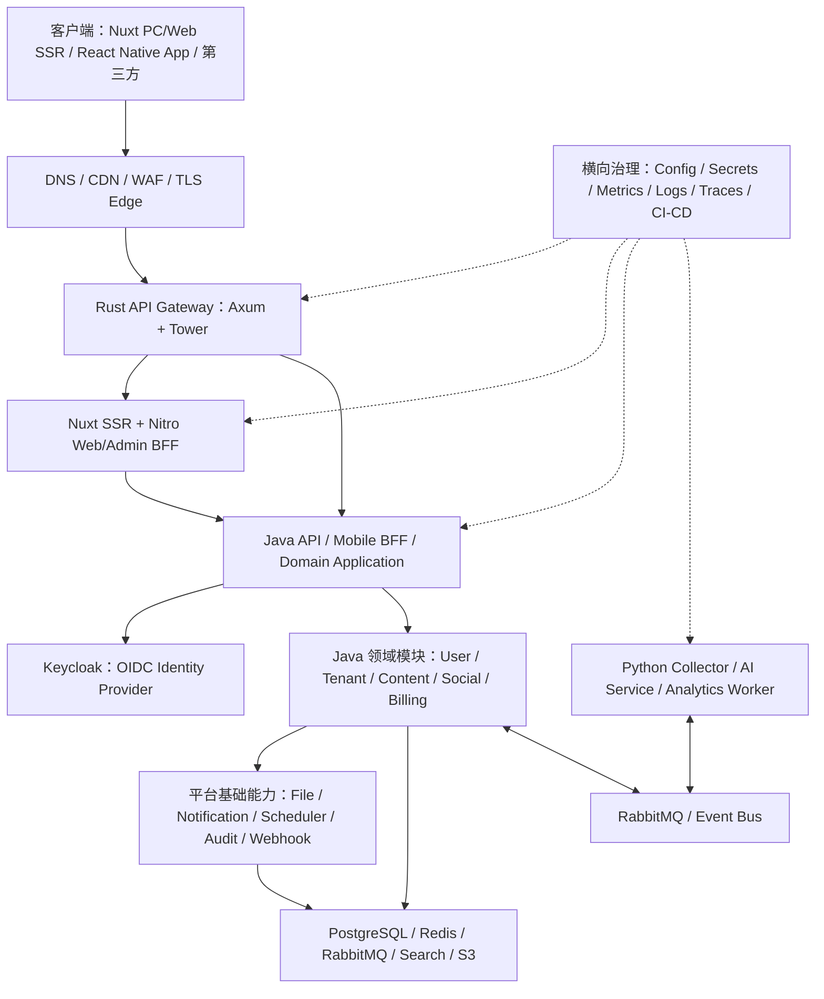

# 互联网平台实验室（需求雷达 Demand Radar）
## 完整项目需求与标准后端架构规范（供 AI IDE 生成代码）

- 文档版本：1.1（多语言架构修订版）
- 文档日期：2026-11-03
- 项目类型：面向全球用户的多租户 SaaS + 内容/数据平台
- 文档用途：产品需求、系统架构、工程规范、分阶段 AI 代码生成依据
- 网关与通用 HTTP 中间件：Rust stable + Axum 0.8.x + Tokio + Tower/Tower HTTP
- 业务后端与微服务：Java 25 LTS + Spring Boot 4.0.x（依赖兼容性不足时可通过 ADR 回退 Java 21 + Spring Boot 3.5.x）
- 数据采集、数据分析与 AI：Python 3.13+（具体版本按依赖兼容矩阵锁定）
- 前端：TypeScript；PC/Web 使用 Nuxt 4 + Vue 3 SSR；Android/iOS 使用 React Native + Expo；桌面客户端按需使用 Tauri
- Web 交付方式：Nuxt 服务端渲染（SSR）+ Nitro Server Routes/BFF，不采用纯 SPA；核心业务 API 由 Java 服务提供
- 架构策略：先模块化单体 + 独立 Rust Gateway / Nuxt SSR / Python Worker，后按领域边界渐进拆分 Java 微服务

> 本文中的 MUST/必须、MUST NOT/禁止、SHOULD/建议、MAY/可选是工程约束用词。AI 代码生成器必须遵守。本文是一个可执行的工程蓝图，不代表第一期就要把所有组件部署成独立微服务。

---

# 0. 给 AI IDE 的最高优先级执行指令

你是本项目的首席架构师和高级全栈工程师。请先完整阅读本文件，再创建或修改代码。严格按里程碑实现，不允许一次性生成所有未来阶段的代码。

## 0.1 必须遵守的规则

1. **先确认仓库状态**：先查看已有文件、技术栈和 Git 状态；不得覆盖用户已有实现，不得擅自删除文件。
2. **按阶段交付**：一次只实现当前指定里程碑。每一阶段结束必须运行编译、自动化测试、数据库迁移检查和启动检查，并报告真实结果。
3. **不得伪造完成**：不得用空方法、硬编码成功、假数据、TODO、`return null` 或仅有接口没有实现来冒充功能完成。未实现的能力必须明确标注为未实现。
4. **不擅自改变架构**：模块边界、数据所有权、接口规范、安全要求和技术选型以本文为准。需要改变时，先提出 ADR（架构决策记录），说明原因、影响、迁移方案。
5. **不越权访问数据**：一个领域模块不得直接读写另一个领域模块的数据库表；跨模块通过公开应用接口或领域事件通信。
6. **不把所有代码放入 common**：`common` 只放真正无业务含义的通用类型和基础工具。业务规则必须留在所属领域。
7. **安全优先**：不得自行设计密码加密算法，不得明文保存密码、验证码、支付密钥或第三方访问令牌；认证优先对接 Keycloak / OIDC。Rust 网关只做入口 Token 校验和安全上下文传递；Java 业务服务必须再次验证 Token 并执行资源级授权。所有资源访问必须服务端授权。
8. **配置外置**：密钥、密码、Token、数据库连接串不得提交到 Git。提供 `.env.example`，真实 `.env` 必须被忽略。
9. **数据库变更必须迁移化**：使用 Flyway；禁止依靠 ORM 自动建表或自动改表；每次表结构变更都要提交版本化迁移脚本。
10. **接口先契约后实现**：对外 API 必须有 OpenAPI 文档；消息事件必须有版本化 Schema；不允许只写 Controller 而没有接口说明。
11. **可观测性内建**：所有 HTTP 请求、后台任务、消息消费都要有 request_id / trace_id、结构化日志、耗时和错误指标。
12. **测试不可省略**：至少包含单元测试、集成测试；关键权限、租户隔离、幂等、状态机和支付回调必须有针对性测试。
13. **保持可运行**：每阶段结束仓库都必须能按 README 启动。开发环境优先使用 Docker Compose。
14. **不要过度微服务化**：第一期使用模块化单体；只有明确的扩缩容、团队所有权、故障隔离或发布独立性理由，才拆为独立服务。
15. **时间处理**：数据库统一保存 UTC 时间；API 使用 ISO 8601；展示层按用户时区转换。
16. **国际化**：面向全球用户，用户可选语言和时区；首期至少支持英文、简体中文；不能把时区写死为服务器时区。
17. **所有第三方采集遵守平台条款、公开 API 限制、速率限制和隐私要求**；不得实现绕过登录、验证码、访问控制或反爬限制的功能。

## 0.2 首次接手仓库时的工作顺序

1. 阅读本文和仓库现状。
2. 输出简短的实施计划和待确认风险；能根据本文确定的事项不得反复询问用户。
3. 建立目录结构、README、架构决策记录、`.env.example`、`.gitignore`、Docker Compose。
4. 先实现第一里程碑，不要顺手实现后续阶段。
5. 执行构建、测试、迁移和启动验证。
6. 汇报：新增/修改文件、已实现功能、运行命令、测试结果、未完成项、下一阶段建议。

## 0.3 AI 每次执行任务的输出格式

- 本次目标与范围
- 影响的模块和文件
- 实现内容
- 数据库迁移
- API / 事件契约变化
- 安全与权限考虑
- 测试用例和实际测试结果
- 启动 / 验证命令
- 明确的未完成事项

---

# 1. 项目概述

## 1.1 项目名称

**需求雷达 Demand Radar（内部代号 RadarHub）**。

这是一个面向全球个人用户、独立开发者和小团队的 SaaS 平台。平台从 Reddit、Hacker News 等公开或授权来源收集用户反馈和问题，经过清洗、去重、分类、热度分析和 AI 归纳，帮助用户发现真实需求、研究市场机会，并管理自己的调研工作空间。

选择这个业务载体的目的：在一个真实产品中覆盖互联网后端常见技术，而不是为了练习而堆砌互不相关的 Demo。

## 1.2 产品角色

- 访客：浏览公开内容、查看公开专题和产品介绍。
- 注册用户：收藏痛点、评论、订阅关键词、使用有限 AI 分析额度。
- 付费个人用户：使用更高的采集、分析、导出和订阅额度。
- 工作空间所有者：创建工作空间、邀请成员、分配角色、管理订阅。
- 工作空间成员：共同收藏、标注、分析和管理调研资料。
- 内容审核员：审核内容、处理举报和违规来源。
- 运营人员：维护分类、来源、专题、公告和运营活动。
- 财务人员：查看订单、支付、退款和账单记录，不得修改原始支付流水。
- 系统管理员：管理平台配置、角色、系统任务和审计，不得绕过审计直接篡改业务记录。
- 服务账号：供内部 Worker 或第三方 API 调用，具备最小权限。

## 1.3 核心产品功能

1. 多来源数据采集：来源适配器、定时采集、增量采集、失败重试、速率限制。
2. 内容归一化：原始数据存档、标准化、URL 规范化、去重、分类、标签、质量评分。
3. 痛点发现：痛点列表、详情、分类、筛选、排序、趋势、来源追溯。
4. 社区互动：评论、回复、点赞、收藏、关注、举报。
5. 工作空间：个人/团队空间、成员邀请、角色权限、项目/专题、共享收藏。
6. 搜索与推荐：全文搜索、筛选、热门榜、个性化推荐、搜索历史。
7. AI 分析：痛点摘要、问题归因、目标用户、现有替代方案、付费意愿线索、解决方案方向、市场风险、开发建议、证据引用。
8. 订阅与商业化：套餐、试用、订阅、额度、订单、支付、退款、发票/收据。
9. 通知：站内通知、邮件、可选 Push/Webhook。
10. 文件与导出：头像、附件、分析报告、CSV/Excel 导出。
11. 开放平台：API Key、开发者应用、Webhook、调用额度、API 文档。
12. 管理后台：用户、租户、来源、内容审核、AI 配置、套餐、订单、通知、审计和任务管理。
13. 数据分析：采集量、内容质量、用户活跃、漏斗、订阅转化、AI 成本和系统运行指标。

## 1.4 项目目标

- 建立可长期复用的互联网后端架构规范。
- 实际覆盖身份、权限、网关、BFF、领域建模、事务、缓存、消息、异步任务、搜索、AI、文件、支付、SaaS 多租户、可观测性、容器部署和 CI/CD。
- 先保证单机/小规模部署可运行，再逐渐练习分布式架构。
- 每个模块必须能说明其职责、数据所有权、公开接口、依赖关系和测试方式。

## 1.5 非目标和边界

- 不以真实百万/千万 QPS 为首期目标，不为没有数据依据的容量预先分库分表。
- 不首期自研 OAuth/OIDC 身份提供商、支付通道、短信网关、对象存储或消息队列。
- 不实现绕过第三方网站访问限制的爬虫。
- 不将 AI 输出当作事实；必须保存来源证据、模型、提示词版本和置信度/不确定性。
- 不把推荐、风控、数据仓库、Kubernetes 等所有复杂能力塞进 MVP。

---

# 2. 技术选型和技术原则

## 2.1 首选技术栈（按语言明确职责）

| 层次/模块 | 语言与技术 | 职责和约束 |
|---|---|---|
| API Gateway | Rust stable + Edition 2024 + Axum 0.8.x + Tokio + Tower/Tower HTTP | 自研统一 API 网关；负责路由、反向代理、限流、超时、熔断、JWT 边缘校验、请求上下文和流量治理；不写业务规则、不访问业务库 |
| Rust HTTP 中间件 | Rust + Tower `Layer`/`Service` + tower-http | 抽取 Request ID、Trace Context、超时、压缩、请求体限制、安全 Header、CORS、限流、熔断、访问日志、认证上下文等可复用网络层能力；中间件以 crate 复用，不跨进程链接 Java/Python |
| 业务后端 | Java 25 LTS + Spring Boot 4.0.x + Spring MVC | 用户中心、租户、内容、互动、订阅、订单、支付、运营等核心领域；模块化单体起步，逐步拆成 Java 微服务 |
| Java 安全 | Spring Security OAuth2 Resource Server + OIDC | 业务服务独立验证 Keycloak JWT；执行角色、租户和资源级授权；不信任网关转发的未签名身份 Header |
| Java 数据访问 | Spring Data JDBC/JPA（按领域选择）+ Flyway | Java 领域服务拥有权威业务数据；禁止 ORM 自动建表/改表；复杂查询允许显式 SQL |
| Java 微服务治理 | Spring Boot Actuator、Resilience4j（按需）、Spring AMQP、Spring Cloud（后期按需） | 健康检查、消息、韧性、服务配置和服务发现；不为使用生态而过早引入完整 Spring Cloud 套件 |
| Web / PC 浏览器 | TypeScript + Nuxt 4 + Vue 3 + Nitro SSR | PC/H5 响应式站点、公开网站、用户控制台、管理后台；Nuxt 服务端输出 HTML，Nitro Server Routes 承担 Web/Admin BFF 适配；不放核心领域规则 |
| 移动 App | TypeScript + React Native 0.88.x + Expo SDK 58（以官方兼容矩阵为准） | Android/iOS 客户端；统一组件、路由、网络层、安全存储、推送、深链和版本管理 |
| 可选桌面 App | TypeScript + Tauri 2 + Vue/React | 只有确有桌面端需求时启用；Rust 只作为 Tauri 宿主，不与网关共享业务代码 |
| 前端工程 | pnpm workspace + TypeScript strict + ESLint + Prettier + Vitest + Playwright | 共享类型、API SDK、组件库、主题、国际化；由 OpenAPI/JSON Schema 生成类型，禁止手工维护多份重复 DTO |
| 身份提供商 | Keycloak（OIDC/OAuth 2.0） | 权威管理凭证、登录、SSO、第三方身份源、MFA、用户认证会话与 Token；不管理内容/订单等业务数据 |
| 主数据库 | PostgreSQL | 关系型权威数据；Flyway 管理迁移；MVP 可共享实例但按领域独立 Schema/表命名空间和数据访问边界 |
| 缓存 | Redis | 缓存、短期状态、分布式限流计数、幂等辅助；不能作为业务权威数据源 |
| 消息队列 | RabbitMQ | 首期异步任务和领域事件；后续需要高吞吐事件流时再引入 Kafka |
| 搜索 | 首期 PostgreSQL Full Text Search；后续 OpenSearch | 先用现有数据库能力；数据量和搜索需求证明必要时再部署专用搜索集群 |
| 对象存储 | S3 兼容存储；开发环境 MinIO | 文件元数据与文件内容分离 |
| 采集 Worker | Python 3.13+ + HTTPX + Pydantic + Ruff + pytest | 来源适配器、采集、清洗、标准化、checkpoint、重试；通过内部 API/MQ 接入，不直接写 Java 领域数据库 |
| AI Service / Worker | Python 3.13+ + FastAPI（内部 API）+ Pydantic + 主流模型 SDK | LLM Provider Adapter、Prompt、Embedding、RAG、评估、结构化输出和异步推理；AI 任务生命周期、用户额度、计费和权限仍由 Java 领域服务拥有 |
| 数据分析 | Python 3.13+ + Polars/Pandas + DuckDB；后期 ClickHouse | 离线分析、ETL、实验、统计建模；分析结果通过内部 API/事件回写，不绕过领域数据所有权 |
| 可观测性 | OpenTelemetry + Prometheus + Grafana + Loki/兼容日志平台 | Rust、Java、Python、TypeScript 全链路 trace、metrics、logs；所有语言传递 W3C Trace Context |
| 部署 | Docker Compose（首期）；Kubernetes（进阶） | Compose 一键启动；镜像按服务构建；后期再练习 K8s、滚动发布和自动扩缩容 |
| API 契约 | OpenAPI 3.x | Java HTTP API 为权威业务契约；生成 TypeScript SDK/客户端类型；Rust Gateway 按契约路由/代理，不改变领域语义 |
| 事件契约 | CloudEvents 1.0 + JSON Schema | 跨 Rust/Java/Python 的消息信封、版本、追踪和幂等约定 |

**版本锁定原则：** 表中主版本是架构基线，不是让 AI 猜测或盲目安装“最新”。开始编码时先查官方稳定版与兼容矩阵；将 Rust toolchain、Cargo.lock、JDK、Maven Wrapper、Python runtime/lockfile、Node.js、pnpm lockfile、容器镜像版本固定。生产镜像禁止使用 `latest`。Spring Boot 4.x 与 Java 25 的兼容性以 Spring 官方系统要求为准；如果关键依赖尚不兼容，可选择 Java 21 + Spring Boot 3.5.x，并记录 ADR。Nuxt、React Native、Expo 必须使用彼此兼容的版本组合。

## 2.2 语言职责边界（强制）

| 语言 | 必须负责 | 明确禁止/避免 |
|---|---|---|
| Rust | API Gateway、Tower HTTP 中间件、网络代理/协议适配、对性能和资源控制敏感的通用基础设施组件 | 不实现订单/会员/用户等业务领域；不成为业务数据库的写入者；不在 Rust 网关重复实现完整 IAM/IdP |
| Java | 所有核心业务规则、领域模型、事务、用户中心、租户、权限策略、账单订单支付、业务 API、逐步拆出的微服务 | 不把采集器/LLM 推理模型实现塞进 Java；不绕过领域边界直接读写其他服务数据库 |
| Python 3 | 数据采集、清洗、去重、分析、ETL、AI/LLM、Embedding、RAG、评估和离线实验 | 不成为用户/订单/支付等核心业务数据的权威写入端；不直接修改 Java 业务表 |
| TypeScript | Nuxt PC/Web SSR、管理后台、H5、React Native App、可选 Tauri 桌面端、前端 SDK/UI/状态管理 | 浏览器/App 不能持有服务端秘密；前端不作为授权权威；不在前端复制核心业务规则 |

**跨语言边界规则：**

1. Rust Gateway、Nuxt/Nitro、Java、Python 都是独立进程/部署单元时，必须通过 HTTP REST、SSE、WebSocket、RabbitMQ 事件或明确的 gRPC 契约通信；禁止依赖对方的内部代码包。
2. OpenAPI 是同步 HTTP API 契约来源；JSON Schema/CloudEvents 是消息契约来源。由契约生成 TS Client、必要的 Rust/Java 类型，不允许各语言手工维护互不一致的字段。
3. 核心业务数据由 Java 领域服务拥有；Python 采集数据通过导入 API/事件写入 Content 域；AI 结果通过 Analysis API/事件提交给 Java AI 域。
4. Rust Gateway 校验 Token 只能作为边缘防护；Java Resource Server 必须再次验证 issuer、audience、签名、过期时间并执行授权。
5. Rust middleware 是 HTTP 网络层能力；Java 业务服务仍需具备自己的 Spring Security Filter/Interceptor、参数校验和审计适配。不得因为“网关已处理”而移除服务端授权。
6. TypeScript SSR/BFF 只组织客户端页面数据、会话和请求适配；不得直接连接 PostgreSQL/Redis/RabbitMQ，不得绕过 Java Domain/Application。
7. Python Worker 通过最小权限服务身份访问内部接口；消息只携带完成任务所需的最少数据，不携带密码、Refresh Token 或不必要的个人信息。

## 2.3 技术选型理由

- Rust + Axum/Tower 用于自研入口网关和可复用 HTTP 中间件，训练异步运行时、网络 I/O、反向代理、流量控制和高性能服务工程。Axum 基于 Tokio/Hyper，并通过 Tower 生态组合中间件；不要把 Axum 误解为自带一套独立 middleware 系统。
- Java + Spring Boot 用于核心业务和微服务，重点训练 DDD、事务、状态机、领域事件、企业级安全、数据访问和服务治理。
- Python 用于数据采集、数据处理与 AI，利用成熟的数据科学和模型生态；Java 保持业务权威数据和计费权限边界。
- TypeScript 覆盖所有面向用户的终端。Nuxt SSR 服务端输出 HTML，满足 PC/Web 页面服务端渲染需求；React Native/Expo 用于原生移动 App。该方案不是 Java 服务端模板引擎与业务代码同进程的传统前后端合一，但不是纯 SPA：页面首屏由服务端渲染，Nitro 可承担 Web BFF。
- Keycloak 提供标准 OIDC/OAuth 身份协议，避免自研密码、MFA、SSO 和 Token 签发体系。
- PostgreSQL 作为主要关系数据库；Redis、MQ、对象存储和搜索引擎按实际需求增加。

## 2.4 架构原则

1. 领域驱动设计（DDD）划分业务边界，使用有意义的限界上下文。
2. 依赖倒置：Domain 不依赖 Web、ORM、MQ、外部服务 SDK。
3. 模块内高内聚，模块间通过明确契约低耦合。
4. 单一数据所有者：一个业务数据只能有一个权威写入方。
5. 无共享数据库写入：其他服务不得直接修改该领域表。
6. 同步调用用于即时查询/命令；异步事件用于跨领域通知和解耦。
7. 先模块化单体，后按边界拆服务；不按 Controller、Entity、DAO 等技术类型拆服务。
8. 默认无状态应用；会话、任务和必要状态外置。
9. 安全默认拒绝（deny by default），授权必须在服务端执行。
10. 失败可见、可重试、可补偿、可追踪；不静默吞异常。

# 3. 总体分层架构

## 3.1 逻辑分层



## 3.2 各层职责总表

| 层 | 主要实现语言/技术 | 负责什么 | 不负责什么 |
|---|---|---|---|
| 客户端 | TypeScript | 展示、交互、收集用户输入、客户端状态和导航 | 不作为权限判断权威，不存储服务端密钥 |
| 边缘层 | CDN/WAF/负载均衡产品 | DNS、CDN、WAF、DDoS 基础防护、TLS 入口 | 不处理领域规则 |
| API Gateway | Rust + Axum/Tower | 路由、代理、负载均衡、限流、请求限制、JWT 边缘校验、流量治理 | 不聚合复杂业务数据、不修改业务数据库、不代替业务授权 |
| HTTP 中间件层 | Rust + Tower crates | Request ID、Trace Context、超时、限流、熔断、压缩、安全 Header、CORS、日志 | 不承载领域业务状态 |
| IAM | Keycloak + Java Resource Server | 登录、凭证、OIDC、Token、MFA；Java 校验身份并执行业务授权 | 不管理文章、订单和用户业务资料 |
| BFF / 表现适配层 | Nuxt/Nitro TypeScript；Mobile BFF 可用 Java | 面向客户端适配、聚合、裁剪、SSR 页面数据组织 | 不拥有核心业务数据库、不定义领域规则 |
| 应用层 | Java + Spring Boot | 用例编排、事务边界、调用领域模型 | 不成为所有业务的巨型服务 |
| 领域层 | Java | 业务实体、值对象、规则、不变量、状态机、领域事件 | 不依赖框架和基础设施 |
| 数据采集/AI/分析 | Python 3 | 采集、清洗、分析、模型推理、RAG、ETL | 不拥有核心账户、订单、支付权威数据 |
| 基础平台层 | Java 模块/服务；网络通用组件可用 Rust | 文件、通知、调度、审计、配置、Webhook 等通用平台能力 | 不替业务决定“何时退款/如何授予会员”等规则 |
| 数据/中间件层 | PostgreSQL / Redis / RabbitMQ / S3 | 数据持久化、缓存、消息、搜索、对象存储 | 不承载领域决策 |
| 治理层 | OpenTelemetry 及相应生态 | 监控、日志、追踪、部署、密钥、服务治理 | 不拥有业务数据 |

## 3.3 外部请求路径

- PC/Web 页面：Browser → CDN/WAF/TLS Edge → Rust Axum Gateway → Nuxt/Nitro SSR → Java Domain API → Repository。
- Android/iOS API：React Native App → Edge → Rust Gateway → Java Mobile API/BFF → Java Domain Module。
- 管理后台：Admin Browser → Edge → Rust Gateway → Nuxt/Nitro Admin SSR/BFF → Java Admin Use Cases。
- 登录/授权：客户端/SSR BFF 通过 OIDC 与 Keycloak 交互；Gateway 可按配置校验 JWT；每个 Java Resource Server 必须再次验证 JWT 并执行权限检查。
- 内部服务调用：优先使用内部 API 或事件；跨网络调用必须使用服务身份认证、超时、限流和链路追踪。
- AI 长任务：客户端创建分析任务 → Java AI Domain 校验权限和额度并返回 `job_id` → RabbitMQ → Python Worker 执行 → 结果通过内部 API/事件回传 Java → 客户端轮询或 SSE 订阅进度。

客户端不得直接访问内部服务、数据库、Redis、RabbitMQ、Keycloak 管理接口或对象存储私有管理端点。

# 4. API 网关层（Rust Gateway）需求

本项目自研 API Gateway，使用 Rust + Axum + Tokio + Tower/Tower HTTP。CDN/WAF/TLS Edge 可以使用成熟产品，但业务 API 的统一路由和网关核心逻辑必须由 Rust Gateway 实现。Axum 负责路由/HTTP Handler，Tower `Layer`/`Service` 负责可组合的中间件链。不得误把 Axum 本身当作完整 API Gateway 产品。

## 4.1 组件职责和进程边界

- **Edge（外部边缘设施）**：DNS、CDN、WAF、DDoS 防护、可选 TLS 终止。可用 Cloudflare、云厂商或 Nginx/Caddy；不写业务逻辑。
- **Rust API Gateway（数据面）**：接收外部 HTTP 请求、匹配路由、代理到 Nuxt/Java/Keycloak 指定上游、负载均衡、流量控制、安全过滤、请求上下文和可观测性。
- **Gateway Config（首期配置面）**：首期使用受版本控制的 YAML/TOML 配置，启动时校验；后期才开发私有管理 API、动态配置推送和多实例一致性。管理面不得公开到公网。
- **Rust Middleware Crates**：抽象可复用 Tower Layer，不应把所有逻辑写在 Gateway Handler 中。

## 4.2 必须具备的网关功能

| 类别 | 功能细节 |
|---|---|
| 请求接入 | HTTP/1.1、HTTP/2；连接管理；健康检查；请求体大小限制；合理的 Header 限制 |
| 路由匹配 | Host、Path、Method、Header、Query（仅白名单字段）匹配；路径重写；API 版本路由 |
| 反向代理 | 代理到 Nuxt SSR、Java API、Keycloak OIDC 等明确上游；保留必要的请求语义；屏蔽上游内部地址 |
| 上游管理 | 多实例 Upstream、轮询/加权/最少连接等策略（按实际依赖支持）、健康探测、故障实例摘除 |
| 服务发现 | 首期静态/DNS 配置；后期接入注册发现；变更时原子更新上游列表 |
| TLS | 支持上游 TLS；公网 TLS 可在 Edge 终止；证书热更新/轮换有文档；严禁明文传输敏感内部流量 |
| 请求上下文 | 生成或校验 Request ID；传递 W3C `traceparent`/`tracestate`；清除外部伪造的内部身份 Header |
| Token 边缘校验 | 从 Keycloak OIDC Discovery/JWKS 获取公钥并缓存；校验签名、允许算法、issuer、audience、exp、nbf；支持 `kid` 轮换 |
| 认证上下文 | 验证通过后只传递最小化、来源可信的身份上下文；内部 Header 必须由网关覆盖并通过内网/mTLS 信任边界保护；服务端仍需独立校验 JWT |
| 限流 | 按 IP、API Key、用户/租户（仅从可信已验证身份取得）限流；本地快速限流 + Redis 分布式限流；令牌桶/滑动窗口按场景选择 |
| 并发控制 | 最大并发、连接池上限、上游并发隔离、防止慢请求拖垮整个 Gateway |
| 超时控制 | 连接、请求头、请求体、上游连接、上游读取、整体 deadline；支持客户端断连时取消上游任务 |
| 重试 | 仅对明确可重试且幂等的请求；限制次数、退避和总 deadline；POST/支付/退款默认不自动重试 |
| 熔断/隔离 | 按 Upstream/路由统计连续失败、打开/半开/关闭状态；隔离故障上游，不能引起全网关阻塞 |
| 安全防护 | IP 黑白名单、路径规范化、防路径穿越、Header 清理、请求体限制、基础 Bot/WAF 联动 |
| CORS | 按路由白名单配置 Origin、Method、Header、Credentials；禁止任意 Origin + Credentials |
| 安全 Header | HSTS（由 TLS 策略决定）、X-Content-Type-Options、Referrer-Policy 等；CSP 优先由 Web 应用配置 |
| 压缩/流式 | Gzip/Brotli（按客户端支持）、SSE/WebSocket Upgrade 透传、流式请求/响应转发；不得把大文件全部读入内存 |
| 灰度发布 | 按 Header、Cookie、用户分桶或比例选上游；支持路由权重和快速回滚 |
| 缓存 | 只缓存明确标记的公开 GET 响应；私有/租户数据默认不在 Gateway 共享缓存 |
| 访问日志 | method、route_id、status、latency、upstream、request_id、trace_id；脱敏 Authorization/Cookie/PII |
| 指标监控 | QPS、并发、连接数、P50/P95/P99、5xx、上游失败、限流、熔断、重试和配置加载错误 |
| 管理安全 | 私有管理端点、配置校验、版本、回滚、审计；禁止公网直接暴露管理接口 |

## 4.3 Rust Gateway 的 crate 和模块划分

```text
apps/api-gateway/
  src/
    main.rs                 # 启动、优雅退出、装配 Router 和 Layer
    config/                 # 配置加载、校验、热更新抽象
    routes/                 # Host/Path/Method 路由表
    proxy/                  # Upstream 选择、请求/响应代理、流式转发
    upstream/               # 健康检查、连接池、实例状态
    auth/                   # OIDC Discovery、JWKS 缓存、JWT 边缘校验
    observability/          # metrics、tracing、health/readiness
    admin/                  # 仅内网管理/诊断端点（后期启用）
    error/                  # 网关错误码和响应转换
crates/
  gateway-config/            # 路由/上游配置 schema 和校验
  middleware-request-context/ # Request ID、可信客户端上下文
  middleware-authn/          # OIDC/JWT 校验（只做认证，不做领域授权）
  middleware-rate-limit/     # 本地/Redis 限流 Layer
  middleware-timeout/        # deadline、上游超时
  middleware-circuit-breaker/# 熔断、隔离、恢复
  middleware-security/       # Header 清理、请求体限制、CORS、安全 Header
  middleware-observability/  # 访问日志、metrics、trace
  gateway-testkit/           # 上游 Mock、契约测试辅助
```

**推荐实现组件（不是要求全部第一期引入）：** Axum 用于路由与控制端点；Hyper/Hyper-util 用于可控的 HTTP 反向代理和流式 Body 转发；Tokio 提供异步运行时；Tower/Tower HTTP 提供 Layer 组合；Rustls 用于 TLS；Serde 用于配置和数据结构；Tracing 用于结构化日志/Span；Redis Rust Client 用于分布式限流。JWT/JWKS 使用维护活跃、支持算法白名单和密钥轮换的库；禁止自己实现密码学、JWT 签名或 TLS。

**建议的 middleware 装配顺序：** Request ID/Trace Context → 访问日志 Span → 可信代理 IP 解析与外部身份 Header 清理 → CORS/预检 → Header/Body 限制 → 路由级 JWT 校验 → IP/用户/租户限流 → 并发控制/整体 Timeout → 上游熔断/有限重试/代理 → 响应安全 Header/压缩。实际顺序必须通过集成测试证明；公开路由、登录回调、SSE、上传路由可以配置不同 Layer 组合。

允许合并小 crate，禁止为拆 crate 而过度拆分。对外暴露稳定、窄小的 Layer/配置接口。通用 crate 不得依赖具体业务模块。

## 4.4 配置和路由约定

- `/`、`/pages/**`、`/assets/**`：Nuxt Web SSR。
- `/admin/**`：Nuxt Admin SSR（可同一 Nuxt 应用，也可独立部署）。
- `/api/mobile/v1/**`：Java Mobile API/BFF。
- `/api/admin/v1/**`：Java 管理 API（供 Nuxt Admin Server Routes 调用）。
- `/api/open/v1/**`：Java Open Platform API。
- `/realms/**`、OIDC discovery/JWKS/auth/token 等路径：按 Keycloak 独立域名或受控路由配置；不得由业务应用伪造。
- `/health/live`、`/health/ready`：网关探针；内部服务健康端点不直接暴露公网。
- Gateway 路由配置包含 route_id、匹配条件、upstream、超时、限流、重试、安全策略和灰度规则；配置 schema 有版本。

## 4.5 禁止事项

- 不在网关写用户注册、订单、会员、内容等业务状态机。
- 不把网关作为唯一的对象级授权边界；Java 业务服务必须重新验证身份和资源权限。
- 不连接业务数据库、不修改业务记录、不管理业务事务。
- 不记录密码、完整 Token、Cookie、支付敏感信息或完整个人敏感数据。
- 不对 POST/支付/退款等写请求盲目重试。
- 不在网关中构建复杂页面聚合；这属于 BFF。
- 不从客户端提供的 `X-User-Id`、`X-Tenant-Id`、`X-Roles` 直接建立可信身份。

## 4.6 安全与可靠性要求

- 网关到内部服务优先私有网络；跨主机/跨网络环境采用 TLS，后期按需要 mTLS。
- 如果 Gateway 向后端注入身份 Header，必须先删除外部同名 Header，再从已验证 JWT 生成，并且后端只在可信网络和明确的认证机制下接受；推荐后端仍直接校验 JWT。
- Redis 不可用时的限流策略必须明确（安全敏感 API 默认 fail-closed 或采用保守本地限流，普通公开读接口可按 ADR 降级）。
- 配置热更新采用“先完整校验、再原子切换”；错误配置不得破坏正在服务的旧配置。
- 优雅关机时停止接收新请求，等待在途请求至 deadline，正确关闭连接和 tracing exporter。

## 4.7 验收

- 未知路由返回统一 404；不泄露上游内部地址。
- 超限请求返回 429 和合理 `Retry-After`。
- 上游超时可控，不出现无限等待；客户端断连后上游可取消。
- 外部伪造身份 Header 不得改变真实身份。
- JWT 无效、过期、错误 issuer/audience、未知 kid 等按安全策略拒绝。
- SSE/WebSocket/大文件流转发不会被错误缓冲或截断。
- 同一 trace_id 能串联 Rust Gateway、Nuxt、Java、Python 日志和 Trace。
- `cargo fmt --check`、`cargo clippy -- -D warnings`、`cargo test` 通过。

# 5. 身份认证与授权层（IAM / Auth）需求

## 5.1 权责划分

首期 Keycloak 是身份提供商（IdP）：权威管理登录身份、密码/Passkey、认证流程、MFA、SSO、OIDC Token 和登录会话。业务系统只保存外部身份 subject 与内部 `user_id` 的映射，不复制或自行维护密码。

应用权限分三类：

1. **身份认证**：由 Keycloak 完成，回答“当前调用者是谁”。
2. **平台角色/租户权限**：由应用权限模块或 IAM 集成适配层管理，回答“用户在某个租户有哪些角色/功能权限”。
3. **资源级授权**：由拥有资源的业务模块完成，回答“这个用户能否查看/修改这条具体记录”。

## 5.2 认证能力

- 邮箱/密码登录和注册（通过 Keycloak 流程）。
- 邮箱验证、密码重置。
- Google/GitHub/Apple 等外部 IdP 接入，按实际可用性配置。
- OIDC Authorization Code Flow + PKCE。
- MFA：TOTP、Passkey 等按 Keycloak 支持能力启用。
- SSO/单点登出（浏览器端注意各客户端会话一致性）。
- 用户会话查询和撤销。
- 登录失败限制、账户保护和风险事件。
- 服务账号 / Client Credentials 供后台服务调用。
- 用户被禁用、删除或撤销会话时的事件联动。

## 5.3 Token 和会话安全

- Access Token 短有效期；Refresh Token 安全轮换与撤销。
- 资源服务校验 `iss`、`aud`、签名算法白名单、`exp`、`nbf`、`kid`。
- 通过 OIDC Discovery/JWKS 获取公钥，支持密钥轮换。
- 不接受 `alg=none`，不接受未经配置的签名算法。
- JWT 不放入密码、支付信息、完整个人资料或大型权限列表。
- 浏览器 SSR 优先采用服务端会话/BFF Cookie；Cookie 设置 `HttpOnly`、`Secure`、合适的 `SameSite`，并防范 CSRF。
- 移动端使用系统安全存储保存 Token，不写入普通日志或明文文件。
- 登出、账号禁用、Refresh Token 重放等情况必须可撤销会话。

## 5.4 授权模型

- RBAC：用户 → 角色 → 权限；权限粒度至少有资源类型、动作、作用域。
- 租户角色：owner、admin、member、viewer 等，角色只在对应 tenant/workspace 生效。
- ABAC：必要时组合 user、tenant、resource owner、resource status、environment 等属性。
- 资源级授权：每个业务服务都必须在读取/修改具体资源时检查租户归属、资源所有者和操作权限。
- 管理员权限必须区分只读、运营、审核、财务、系统管理员，不得默认所有后台用户拥有超级权限。
- 权限变更需要审计；权限缓存必须有失效策略。

## 5.5 身份与服务认证

- 用户身份通过 OIDC access token 传递。
- 服务间调用使用 client credentials、工作负载身份或 mTLS；不得共用一个长期硬编码管理员 Token。
- 服务账号遵循最小权限，支持轮换、禁用、审计。
- 下游服务不能信任客户端任意传入的 `X-User-Id`、`X-Roles`、`X-Tenant-Id`。

## 5.6 身份事件

至少定义：`IdentityUserCreated`、`IdentityEmailVerified`、`IdentityUserDisabled`、`IdentityUserDeleted`、`IdentitySessionRevoked`。事件只携带必要身份标识和状态，不携带密码或秘密凭证。

---

# 6. 用户中心（User Center）需求

## 6.1 数据所有权

用户中心是业务用户资料的权威拥有者。内部使用稳定的 `user_id`；通过 `idp_subject` 映射 Keycloak 身份。Keycloak 的密码和认证会话不进入用户中心数据库。

## 6.2 账户模块

- 用户业务档案创建/初始化。
- 按 user_id 查询用户；按公开用户名查询公开资料。
- 用户状态：pending、active、suspended、banned、deletion_requested、deleted（状态集合可用枚举/状态机管理）。
- 账户禁用、解禁、注销申请和执行。
- 用户数据导出和隐私删除/匿名化流程。
- 用户创建、资料更新、状态变化事件。
- 防止用户重复映射；`idp_subject` 唯一。

## 6.3 Profile 用户资料

- 昵称、用户名、头像、简介、个人主页。
- 国家/地区、语言、时区。
- 公开字段和隐私可见性设置。
- 资料校验、用户名保留规则和变更频率限制。
- 头像只保存 file_id/object key，不将文件二进制放入 PostgreSQL。

## 6.4 Preferences 用户偏好

- 语言、时区、主题。
- 通知渠道偏好。
- 内容分类偏好、关键词偏好。
- 数据使用和隐私偏好。
- 偏好修改历史（仅必要字段）。

## 6.5 用户关系边界

关注、粉丝、好友、屏蔽等数据达到一定复杂度后归 Social Service；用户中心仅提供用户基础资料和状态查询。不得将所有 user_id 相关表塞入 User Center。

## 6.6 用户生命周期

- 注册成功后创建业务档案。
- 账号禁用后，Auth 阻止登录/撤销会话，业务模块按规则限制写操作。
- 用户注销后，按保留期限处理订单、税务/支付记录等依法必须留存的数据；其余个人数据删除或匿名化。
- 用户数据导出必须校验本人或授权管理员身份并记录审计。

---

# 7. 租户与工作空间（Tenant / Workspace）需求

该模块是 SaaS 多租户训练的核心。

## 7.1 功能

- 个人默认工作空间。
- 创建、修改、归档、删除工作空间。
- 企业/团队租户创建。
- 邀请成员、接受/拒绝邀请、撤销邀请。
- 成员加入、移除、角色修改。
- 租户 owner 转让。
- 租户设置和自定义名称/Logo。
- 套餐、订阅、用量归属到 tenant。
- workspace 内项目/专题/收藏集合。
- 成员操作审计。

## 7.2 租户隔离规则

- 所有租户级业务表必须有 `tenant_id`，或通过明确的所有权关系得到 tenant。
- 所有查询、更新、删除必须强制绑定当前 tenant 上下文；不能信任客户端传来的 tenant_id。
- 唯一索引需要考虑 tenant 范围，如 `(tenant_id, slug)`。
- 每个租户接口必须有跨租户越权测试。
- 后台跨租户查询必须是显式的受控管理用例并写入审计。
- 首期使用共享 PostgreSQL + `tenant_id` 行级隔离；未来可按客户级别升级为 schema/database 隔离。

---

# 8. 聚合层 / BFF 需求

## 8.1 定位与技术归属

BFF（Backend For Frontend）面向具体客户端提供合适的数据接口，不拥有核心业务规则和领域数据库。本项目按语言职责划分：

- **Web/Admin BFF：** 由 Nuxt 4 的 Nitro Server Routes 实现，与 Nuxt SSR 页面同一 TypeScript 工程部署。负责服务端会话适配、页面数据聚合、响应裁剪、表单转发和 SSR 数据装载。
- **Mobile BFF：** 首期由 Java Spring Boot 的 `mobile-api` 接口模块实现；复杂度增长后可单独部署为 Java Mobile BFF 服务。
- **业务 API：** Java 领域模块/微服务提供；BFF 只能通过公开 API 或事件读取数据。
- **Rust Gateway：** 只路由和治理流量，不负责 BFF 聚合。

## 8.2 PC/Web SSR（Nuxt + TypeScript）

- 使用 Nuxt 4 + Vue 3 + TypeScript + Nitro，页面默认 SSR；需要交互的组件在浏览器 hydration 后运行。
- PC、平板、手机浏览器共用响应式 Web 页面；首期不要求把所有页面做成纯 SPA。
- Nuxt Server Routes 可以承担 Web BFF：服务端并行调用 Java API、聚合页面数据、统一错误和缓存策略。
- 浏览器只访问公开站点和 BFF/API 路由；服务端 API 凭证和 Keycloak Client Secret 不得暴露到浏览器 Bundle。
- 登录采用 OIDC Authorization Code Flow；SSR 可使用服务端会话或安全 Cookie。Cookie 设置 `HttpOnly`、`Secure`、合适的 `SameSite`，写操作防 CSRF。
- 需要 SEO 的公开页面输出可抓取 HTML、canonical URL、meta title/description、Open Graph、sitemap、robots 策略。
- 页面组件负责展示和交互；Composable 管理可复用 UI 状态；Nitro server route 负责适配，不包含领域业务规则。
- 页面 Controller/Server Route 不直接访问 PostgreSQL、Redis、RabbitMQ 或对象存储管理接口。

**关于“前后端不分离”的解释：** 本项目使用 TypeScript 做前端，因此不采用 Java 服务端模板引擎同进程模板方案。Nuxt SSR 仍然由服务端生成页面 HTML，用户不需要依赖纯 SPA 首屏渲染；但 Nuxt 与 Java 业务服务是不同运行单元，通过内部 API 契约协作。这是“SSR 页面交付 + 前后端工程分层”，不是把前端模板和 Java 业务代码塞进同一个进程。

## 8.3 Mobile App（React Native + Expo + TypeScript）

- Android/iOS 使用 React Native + Expo；新代码统一 TypeScript，不使用无类型的业务 API 调用。
- 使用 Expo Router 或明确的导航方案；按模块组织页面、组件、hooks、services、state。
- OIDC 使用 Authorization Code + PKCE；Token 使用 Expo SecureStore 等封装底层 iOS Keychain/Android Keystore，不写 AsyncStorage 明文。
- API 请求经过统一客户端，支持超时、取消、网络错误映射、Token 续期和请求追踪。
- App 版本、最低支持版本、强制升级/软升级策略和 API 兼容策略明确。
- 深链、推送权限、通知点击跳转、离线状态、弱网重试和崩溃日志按阶段实现。
- AI 任务使用创建 job + 轮询/SSE（移动端网络环境不适合时可轮询）；不要求前台长期阻塞等待。

## 8.4 Admin Web

- 首期可与主 Nuxt Web 共用代码仓库，按独立 route group、layout、权限中间件和导航区分。
- 管理端 BFF 聚合用户、来源、内容审核、AI 配置、任务、订阅/支付和运营统计数据。
- 后台角色与权限必须由 Java 服务端校验；前端隐藏按钮不构成授权。
- 敏感操作二次确认/审批（退款、封禁、删除来源、密钥轮换等）；每个操作写 Audit Log。
- 管理端使用独立 OAuth Client / Redirect URI / Cookie 策略；不与普通用户页面共享不必要的高权限会话。

## 8.5 BFF 规范

- 只做协议适配、聚合、裁剪和用例入口。
- 并行下游调用必须设置整体 deadline 和单个依赖超时；需要并发上限，避免扇出放大。
- 关键依赖失败时返回可解释错误；非关键模块可返回部分数据并标记降级状态。
- BFF 不直接访问业务数据库，也不持有业务表写入权限。
- BFF 不复制业务规则；相同规则只能在领域服务中有一个权威实现。
- 不在 BFF 做长时间阻塞任务；创建后台 Job 并立即返回 `job_id`。
- BFF 的日志和 Trace 需透传 Request ID、Trace Context；日志中不得记录 Access/Refresh Token、Cookie 或敏感字段。

# 9. 领域业务服务需求

每个领域模块都必须有：公开 API/应用接口、领域模型、数据所有权、权限检查、事务边界、幂等策略、事件契约、审计策略和测试。

## 9.1 内容与痛点服务（Content / Pain Point）

### 数据来源与原始资料
- Source Platform：reddit、hackernews、后续扩展其他来源。
- Source Adapter：每个来源独立适配器，支持启停、配置、凭证引用、限速。
- Source Post：保存来源平台 ID、原始 URL、作者公开标识（必要时脱敏）、发布时间、采集时间、互动指标、语言和原始内容快照。
- Source Snapshot：保留必要的原始响应摘要，用于证据追溯；设置保留期限和隐私策略。
- 来源条款、API 许可、频率限制和删除请求必须进入运营规范。

### 内容归一化
- URL 规范化和 canonical URL。
- 文本清洗、HTML 清理、语言识别。
- 规范化作者和来源信息。
- 相似内容去重：唯一来源 ID + URL 规范化 + 文本指纹/相似度策略。
- 去重必须可解释、可人工恢复，不得误删原始证据。
- 分类、标签、主题和关键词提取。
- 质量评分、热度评分、时效评分。
- 内容状态：pending、published、hidden、rejected、archived 等。

### 痛点实体
- 标题、描述、原始问题文本、语言。
- 归属分类、标签、主题。
- 痛点严重程度、发生频率、用户影响、付费意愿线索。
- 来源证据列表和原始链接。
- 创建时间、首次发现时间、最近出现时间。
- 分析状态、审核状态、公开状态。
- 允许多条来源记录支持一个归纳后的痛点。

### 管理和查询
- 列表、详情、分类、标签、来源筛选。
- 按时间、热度、评论数、评分排序。
- 游标分页用于不断增长的 Feed；普通管理页可使用 offset/page。
- 编辑、合并重复痛点、拆分误合并痛点、隐藏、审核、归档。
- 人工标注：有效/无效、严重程度、目标用户、证据可靠性。
- 导出和专题收集。

## 9.2 采集平台（Collector）

采集器使用 Python 3，作为独立 Worker，不允许直接连接并修改所有业务表。

- Source Adapter 插件接口：`fetch`、`normalize`、`checkpoint`、`health`。
- 支持全量首次采集和增量采集。
- 按来源、账号、API 凭证设置并发和速率限制。
- 记录 cursor/checkpoint，失败后可从断点恢复。
- 网络错误指数退避 + jitter；遵守 Retry-After。
- 失败隔离和 dead-letter 记录；支持人工重跑。
- 保存采集批次、开始/结束时间、数量、错误数、来源状态。
- 对原始内容进行来源标识和溯源。
- 采集结果通过内部 ingestion API 或 MQ 发给 Content 模块。
- 采集器不得绕过登录、付费墙、验证码、访问控制或平台技术限制。
- 支持管理员暂停来源、设置采集窗口、频率和最小质量阈值。

## 9.3 分类与主题服务（Taxonomy / Topic）

- 分类树：创建、编辑、排序、启停、合并。
- 标签：创建、别名、合并、热度、内容关联。
- 主题/关键词订阅：关键词规则、语言、来源范围、通知频率。
- 同义词、拼写变体和多语言映射。
- 主题下关联痛点、内容、工作空间。
- 分类变更后异步重建相关索引。

## 9.4 评论服务（Comment）

- 创建、编辑、删除、回复、列表、分页。
- 评论树深度限制，避免无限递归。
- 评论状态：visible、pending、hidden、deleted。
- 评论作者只能修改/删除自己的评论；管理员按权限审核。
- 防垃圾评论、频率限制、内容审核和举报。
- 评论变更产生事件供通知/统计使用。

## 9.5 互动服务（Interaction）

- 点赞/取消点赞。
- 收藏/取消收藏。
- 浏览/阅读记录（需隐私策略）。
- 分享统计。
- 互动计数异步汇总；关键业务不依赖缓存计数作为唯一事实。
- 唯一约束防止同一用户重复点赞或收藏。

## 9.6 社交关系服务（Social）

- 关注/取消关注。
- 粉丝和关注列表。
- 屏蔽用户和黑名单。
- 好友关系（可选）。
- 关系隐私和列表可见性。
- 关系变更事件。
- 不把社交关系表放进 User Center。

## 9.7 搜索服务（Search）

- 痛点、帖子、用户公开资料、专题和工作空间内内容搜索。
- 全文搜索、多字段权重、筛选、排序、分页。
- 搜索建议、热门查询、搜索历史（可关闭/删除）。
- 索引更新、重建和失败补偿。
- 搜索结果必须再次检查可见性和租户权限，不能仅依赖索引过滤。
- 首期 PostgreSQL FTS；达到需求后引入 OpenSearch。

## 9.8 推荐服务（Recommendation）

- 热门榜、最新榜、分类推荐。
- 基于收藏、浏览、关注主题的个性化推荐（用户可控制）。
- 去重、内容多样性和冷启动策略。
- 记录推荐曝光、点击、收藏等反馈事件。
- A/B 实验、算法版本和效果评估。
- 推荐结果说明和隐藏/不感兴趣反馈。
- 首期可使用可解释规则排序，后续再引入机器学习。

## 9.9 AI 分析服务（AI Analysis）

### 分析任务
- 用户从痛点详情或批量列表发起分析。
- 创建 `analysis_job`，记录请求人、tenant、输入快照、状态、模型、提示词版本、费用估算。
- 状态：queued、running、succeeded、failed、cancelled、expired。
- 任务异步执行；提供状态查询和 SSE 进度推送。
- 同一用户对同一输入可配置幂等键，避免重复扣费。

### 分析输出
- 痛点摘要。
- 目标用户画像。
- 问题产生场景与频率。
- 当前替代方案/竞品线索。
- 现有方案不足。
- 付费意愿证据与证据强度。
- 可行产品方向和 MVP 建议。
- 市场竞争和风险。
- 技术实现复杂度。
- 建议验证实验。
- 引用的来源 URL 和原文片段。
- 不确定性、置信度及需要人工验证的事项。

### 模型治理
- Provider Adapter：对接不同 LLM 供应商，统一调用协议。
- 模型、温度、最大输出、超时和重试配置。
- Prompt Template 版本管理、发布、回滚。
- 结构化 JSON Schema 输出验证；解析失败不得静默接受。
- Token 用量、费用估算、真实费用（可获取时）和模型耗时记录。
- 用户/租户/套餐 AI 额度限制。
- 输入输出敏感信息过滤和日志脱敏。
- 将采集到的外部文本视为不可信数据，防范 Prompt Injection；不得因为源文本包含指令就执行工具或泄漏系统提示。
- AI 结果必须标记为机器生成，不得伪装成确定事实。
- 支持人工反馈：有用/无用、修正结论、举报错误。

### RAG / 向量检索（进阶）
- 对可合法处理的内容切片、embedding、向量索引。
- 查询时按租户和可见性过滤。
- 每个答案存储引用 chunk 和来源。
- 删除源内容时按策略删除/失效相关向量。
- 首期不强制部署独立向量数据库；可从 PostgreSQL + pgvector（确认兼容性）演进。

## 9.10 订单、支付、订阅与权益（Billing）

### Plan / Pricing
- 套餐创建、修改、发布、下线。
- 按月/年订阅周期。
- 套餐功能和额度配置。
- 试用期、折扣、优惠码（后续）。
- 套餐版本快照，避免历史订单因套餐修改而改变。

### Subscription
- 创建订阅、续费、取消、暂停、恢复、到期。
- 订阅状态机和生效时间。
- 订阅归属 user 或 tenant。
- 升级/降级按明确的 proration 规则处理。
- 续费失败、宽限期、重试和到期降级。

### Entitlement / Usage
- 功能权益：是否可用、额度、速率、并发、资源上限。
- 用量记录：AI token、AI 分析次数、采集额度、导出次数、成员数等。
- 使用前预留额度，成功后结算，失败后释放预留。
- 并发扣减需要原子操作；不能只在客户端判断额度。
- 额度变更有流水和审计。

### Order
- 订单创建、订单项快照、金额、币种、状态、超时关闭、取消和退款关联。
- 订单号唯一；金额使用最小货币单位整数或精确 Decimal，禁止 float/double。
- 订单创建和权益开通必须有幂等和状态校验。

### Payment
- Provider Adapter 适配支付渠道。
- 创建支付意图、跳转/客户端支付参数、支付回调、主动查单。
- 回调签名校验、事件去重、幂等入账。
- 支付成功与订单状态更新需可靠协调（Outbox/事件/补偿）。
- 退款申请、审核、退款渠道请求、退款回调和对账。
- 记录完整交易流水；财务记录不可被普通 CRUD 覆盖。
- 不存储银行卡完整卡号、CVV 等卡数据；使用支付服务商托管支付页/Tokenization。
- 处理支付回调重复、延迟、乱序和用户关闭页面等情况。

### Billing / Invoice
- 账单生成、收据/发票数据、税务字段配置（按上线地区法律要求）。
- 交易与账单可追溯、可导出。
- 财务后台只允许授权人员查看敏感交易信息。

## 9.11 运营与管理后台（Admin）

- 用户检索、状态管理、资料查看（敏感字段脱敏）。
- 租户/工作空间查询、成员管理。
- 来源配置、采集状态、采集批次、暂停/恢复。
- 内容审核、举报处理、合并/拆分重复内容。
- 分类/标签/专题管理。
- AI Provider、模型、Prompt 版本配置。
- 订阅、订单、支付、退款查询和受控操作。
- 套餐和权益配置。
- 通知模板和发送记录。
- 任务管理：查看、重试、取消、补偿。
- 系统健康、队列积压、失败率和采集统计。
- 管理员角色、权限和操作审计。
- 高风险操作支持审批/双人复核（按业务需要）。

## 9.12 开放平台（Open Platform）

- 开发者应用注册、审核、禁用。
- API Key 创建、查看一次、轮换、撤销；数据库只保存哈希或安全指纹。
- Key 绑定作用域、租户、IP 白名单、额度和到期时间。
- API 版本管理和弃用通知。
- API 文档、示例和错误码。
- Webhook Endpoint 注册、验证、暂停。
- Webhook HMAC 签名、时间戳和重放防护。
- Webhook 投递记录、重试、死信、手动重放。
- Webhook 消费者必须按事件 ID 去重。
- 按应用和租户统计调用次数、错误率、延迟和额度。

---

# 10. 基础平台服务需求

基础平台只提供通用能力；业务模块拥有业务规则和状态。首期可作为同一应用内的独立模块，后续再抽取。

## 10.1 文件服务 File Service

- 上传/下载/删除、分片上传、断点续传、临时上传凭证。
- 文件元数据、MIME/扩展名/大小校验、哈希、病毒扫描接口。
- 公开文件与私有文件、短期签名 URL、访问权限检查。
- 图片缩放、压缩、格式转换；视频转码为后期能力。
- 对象存储适配、生命周期、清理、配额。
- 数据库只保存 file_id、object_key、owner、tenant、metadata，不存二进制文件。

## 10.2 通知服务 Notification

- 站内通知、邮件、短信、Push 适配器。
- 模板、模板版本、语言、变量 schema。
- 发送任务、投递状态、失败重试、死信、发送频率限制。
- 用户渠道偏好和退订状态。
- 去重键、防止重复通知。
- 业务模块提供事件和模板变量；通知平台负责渠道投递。

## 10.3 SMS / Email Provider Adapter

- 统一供应商接口、超时、限速、重试、错误码映射、费用记录。
- 凭证只从 Secret Store/环境变量读取。
- 国际化模板；邮件域名 SPF/DKIM/DMARC 配置说明。
- 验证码业务由 Auth 管理，SMS/Email 只负责发送。

## 10.4 Scheduler / Job Service

- Cron、一次性任务、延迟任务、周期任务。
- Worker 注册、分配、并发限制、任务租约/锁。
- 状态、执行日志、耗时、重试、取消、超时和死信。
- 支持手动重跑和补偿任务。
- 调度服务只负责触发；具体业务逻辑由所属领域服务实现。

## 10.5 Event / Messaging Platform

- 统一事件封装和 schema 版本。
- Outbox 事务发件箱，避免 DB commit 与消息 publish 双写不一致。
- 消费者幂等、重试、指数退避、DLQ、人工重放。
- 消息保留期、积压监控、消费延迟指标。
- 事件至少一次投递；消费者必须假设重复消息。
- 首期 RabbitMQ；高吞吐事件流/分析场景后续可使用 Kafka。

## 10.6 Audit Service

- 记录 actor、action、resource、tenant、request_id、发生时间、结果和必要变更摘要。
- 记录登录安全、权限变更、用户封禁、退款、套餐变更、配置发布、管理员操作。
- 审计日志禁止普通业务用户修改或删除。
- 敏感字段脱敏；审计查询权限单独控制。
- 依法设置保留期限和归档策略。

## 10.7 Configuration / Feature Flag

- 多环境配置、配置版本、审批发布、回滚、变更审计。
- Feature Flag：用户/租户/百分比灰度、启停、过期清理。
- 敏感密钥放 Secret Manager，不放普通配置表。
- 应用启动时校验必需配置，缺失时快速失败。

## 10.8 ID Service

- 优先使用 UUIDv7/应用生成的高可用 ID；业务流水号单独生成。
- ID 必须唯一、不可复用；不要把数据库自增 ID 暴露为安全凭证。
- 业务编号可使用日期/前缀/序列，但不能作为权限依据。

## 10.9 Rate Limit / Quota

- 网关负责入口流量限速；业务额度服务负责套餐额度和业务配额。
- 可按 IP、账号、tenant、API Key、资源和时间窗限流。
- Redis 原子计数/滑动窗口/令牌桶由具体场景选择。
- 明确超限错误、重置时间和审计策略。

## 10.10 Webhook Delivery

- 事件匹配、签名、超时、重试计划、最大次数、死信。
- 对相同 event_id 不能重复创建业务效果。
- 支持暂停 endpoint、轮换 secret、回放事件。

## 10.11 Rust HTTP Middleware Platform（网关通用中间件）

本节指运行在 Rust/Axum/Tower Gateway 进程内或可复用的技术中间件，不是 RabbitMQ/Redis 这类基础设施产品，也不是跨语言动态链接库。首期以 Tower Layer crate 提供；未来确需内部 HTTP 服务时再独立部署。

| 中间件 | 具体功能 | 约束 |
|---|---|---|
| Request Context | Request ID 生成/校验、客户端 IP 解析可信代理链、请求元数据 | 只信任明确配置的代理网段；覆盖外部伪造内部 Header |
| Trace/Access Log | W3C Trace Context、结构化访问日志、耗时和状态码 | 脱敏 Authorization、Cookie、PII；Trace 不放敏感数据 |
| Authentication Layer | OIDC Discovery/JWKS 缓存、JWT 验签、issuer/audience/exp/nbf 检查 | 只做入口认证；不代替 Java 对象级授权 |
| Rate Limit Layer | 本地令牌桶、Redis 分布式滑动窗口/令牌桶、按 IP/用户/租户限流 | 用户/租户 key 必须来自已验证身份；定义 Redis 故障策略 |
| Timeout Layer | 路由级 deadline、连接/上游超时、取消上游请求 | 超时必须传递，不能只在客户端返回 504 后继续无约束执行 |
| Circuit Breaker Layer | 上游失败统计、Open/Half-open/Closed、恢复探测 | 按 upstream/route 隔离状态；状态持久化非首期要求 |
| Retry Layer | 有界重试、指数退避、可重试状态码 | 默认 GET/HEAD；写请求必须有幂等契约且白名单启用 |
| Body Limit Layer | 请求体大小、上传类型、Header 数量/大小限制 | 大文件走预签名 URL；不要全量缓冲到内存 |
| Security Header Layer | CORS、安全响应 Header、Header allow/deny list | CORS 白名单；不能把 CSP 全部强加给 API 响应 |
| Compression Layer | gzip/br 协商压缩 | SSE、已压缩文件、流式响应按规则跳过压缩 |
| Concurrency Layer | 全局/路由/上游并发上限、连接池保护 | 达到上限快速拒绝或排队，排队必须有容量和 deadline |
| Idempotency Adapter（可选） | 将特定接口幂等键转发到业务端或 Redis 辅助检查 | 支付等权威幂等仍由 Java 业务服务持久化保证 |

Java 应用也必须用 Spring Security Filter、HandlerInterceptor、Bean Validation 等实现本进程必要的安全和观测适配。Rust Layer 不会自动运行在 Java/Python 进程内；不要为了统一而引入 JNI 或跨语言共享内存。

---

# 11. 数据架构和数据库规范

## 11.1 数据所有权

目标架构为每个领域服务拥有自己的数据库/Schema 和凭证。模块化单体阶段可以共用一个 PostgreSQL 实例，但仍必须按模块划分表命名空间、Repository 和迁移文件；禁止跨模块直接 Repository/SQL 访问。

建议领域数据归属：

| 领域 | 核心数据 |
|---|---|
| Keycloak | 密码、认证凭证、身份提供商、登录会话、OIDC 客户端 |
| User | user profile、preferences、账户业务状态、identity subject 映射 |
| Tenant | tenant、workspace、membership、invitation、tenant role |
| Content | source post、pain point、category、tag、source snapshot、moderation |
| Social | follow、block、friendship |
| Engagement | comment、reaction、favorite、view history |
| AI | analysis job/result、prompt version、model config reference、usage record |
| Billing | plan、subscription、entitlement、usage ledger、order、payment、refund、invoice |
| Notification | notification、template、delivery attempt、preference snapshot |
| File | file metadata、access grant、upload session |
| Audit | audit event |
| Analytics | event fact、aggregate、report snapshot |

## 11.2 核心表清单（逻辑模型，字段按实现细化）

### 用户与租户
- `users`：内部 user_id、idp_subject、状态、创建/更新时间。
- `user_profiles`：昵称、用户名、头像 file_id、简介、地区、语言、时区。
- `user_preferences`：语言、主题、通知与隐私偏好 JSON/结构化设置。
- `tenants`：tenant_id、名称、类型、状态、owner_user_id。
- `tenant_members`：tenant_id、user_id、角色、状态、加入时间。
- `tenant_invitations`：邀请对象、角色、token_hash、过期时间、状态。
- `workspaces`：工作空间名称、slug、owner/tenant、状态。

### 内容与采集
- `source_platforms`：平台配置、启停状态。
- `source_accounts`：来源采集账号/配置引用，不保存明文密钥。
- `collection_runs`：采集批次和统计。
- `source_posts`：外部来源原始帖子标准化记录。
- `source_snapshots`：必要的原始证据快照和保留策略。
- `pain_points`：归纳后的痛点。
- `pain_point_sources`：痛点与来源证据映射。
- `categories`、`tags`、`pain_point_tags`、`topics`。
- `content_moderation_records`：审核动作、审核人、理由。

### 互动与社交
- `comments`、`comment_reports`、`reactions`、`favorites`、`follows`、`user_blocks`。
- 关键关系表建立唯一约束，防止重复互动。

### AI
- `analysis_jobs`、`analysis_results`、`prompt_versions`、`model_provider_configs`（只存 secret reference）、`ai_usage_ledger`、`analysis_feedback`。

### 商业化
- `plans`、`plan_versions`、`plan_features`、`subscriptions`、`entitlements`、`usage_ledger`、`orders`、`order_items`、`payment_transactions`、`payment_webhook_events`、`refunds`、`invoices`、`coupons`（后期）。

### 基础平台
- `files`、`file_upload_sessions`、`notifications`、`notification_templates`、`notification_deliveries`、`scheduled_jobs`、`job_runs`、`audit_events`、`outbox_events`、`webhook_endpoints`、`webhook_deliveries`。

## 11.3 数据字段规范

- 主键：优先 UUIDv7；外部来源 ID 单独存储并与 source_platform 组成唯一键。
- 时间：`created_at`、`updated_at` 统一 UTC；使用带时区语义的时间类型。
- 金额：货币代码 + 最小货币单位整数或精确 NUMERIC；绝不使用浮点数。
- 状态：枚举/状态机，状态变化经过业务方法，不允许任意字符串写入。
- 多租户表：必须有 `tenant_id` 并建立恰当索引。
- JSON：只用于变化频繁/非核心结构；核心查询字段必须结构化。
- 删除：明确软删除/硬删除/匿名化策略；不能所有表机械添加 deleted 字段。
- 唯一性：邮箱等认证标识由 Keycloak 管理；公开用户名在用户中心唯一。
- 敏感字段：加密或不落库；密钥仅存 Secret Store。

## 11.4 索引、事务与迁移

- 为实际查询、租户过滤、排序和唯一约束建索引；禁止无依据地给每个字段加索引。
- 列表查询避免 N+1；明确分页策略和稳定排序字段。
- 事务只覆盖本地数据库一致性边界；不跨多个服务保持长事务。
- 使用 Flyway；迁移脚本不可随意修改已在环境执行过的版本。
- 生产环境禁止 `ddl-auto=update/create`。
- 大表变更采用 expand-contract：先兼容新增，再迁移数据，再删除旧字段。

---

# 12. API、事件与通信标准

## 12.1 HTTP API

- REST 路径使用复数资源名、版本号：`/api/mobile/v1/pain-points`。
- JSON 使用 UTF-8；字段命名统一 camelCase。
- GET 查询不得产生业务副作用；DELETE 语义明确。
- 写请求支持 `Idempotency-Key`（支付、订单、AI 扣额、Webhook 等关键接口必须有）。
- 所有请求支持 `X-Request-Id`；Rust Gateway 统一生成/校验并向下游传递；Nuxt、Java、Python 透传并写入日志。
- 分页：管理检索可 page/size；Feed 和海量数据使用 cursor/nextCursor。
- 排序字段必须白名单，禁止拼接用户传入的 SQL/order by。
- 统一错误格式，推荐 Problem Details 风格；包含稳定 errorCode、message、requestId、字段校验错误，不泄露堆栈。
- HTTP 状态码语义正确：400 参数、401 未认证、403 无权限、404 资源不存在或按防枚举策略隐藏、409 状态冲突、422 业务校验、429 限流、5xx 服务异常。
- API breaking change 使用新版本或兼容过渡；不随意删除旧字段。

## 12.2 统一响应示例

成功响应（普通 JSON API）：

```json
{
  "data": {},
  "meta": { "requestId": "req_xxx" }
}
```

错误响应：

```json
{
  "type": "about:blank",
  "title": "Validation Failed",
  "status": 422,
  "errorCode": "PAIN_POINT_TITLE_REQUIRED",
  "detail": "Title is required.",
  "requestId": "req_xxx",
  "fieldErrors": [{ "field": "title", "code": "REQUIRED" }]
}
```

不能为了统一响应而破坏文件流、下载、SSE、Webhook 回调等协议语义。

## 12.3 事件标准

采用 CloudEvents 风格信封，事件至少包含：`specversion`、`id`、`source`、`type`、`subject`、`time`、`datacontenttype`、`dataschema` 和 `data`。可增加 `tenantid`、`traceparent` 等扩展属性。

示例：

```json
{
  "specversion": "1.0",
  "id": "evt_01...",
  "source": "urn:radarhub:content-service",
  "type": "com.radarhub.content.pain-point-published.v1",
  "subject": "pain-point/pp_01...",
  "time": "2026-11-03T08:00:00Z",
  "datacontenttype": "application/json",
  "data": {
    "painPointId": "pp_01...",
    "tenantId": null,
    "categoryId": "cat_01..."
  }
}
```

事件规则：

- 事件是已发生事实，命名使用过去式/已发生语义，例如 `PainPointPublished`。
- schema 版本化；消费者必须兼容新增可选字段。
- 使用 Outbox；发布失败可重试。
- 消费者必须幂等；不能假设消息只到达一次。
- 对顺序有要求的业务按 aggregate_id 分区/路由，明确乱序处理。
- 失败重试达到上限进入 DLQ，并提供监控和人工重放。

## 12.4 通信方式选择

| 场景 | 优先方式 |
|---|---|
| 客户端访问 | HTTPS REST |
| Web 页面 | Nuxt SSR HTML + Nitro Server Routes/表单提交/客户端渐进增强 |
| AI 任务进度 | SSE；双向实时交互确有需要再 WebSocket |
| 浏览器到 Web | HTTPS；页面由 Nuxt SSR 输出 HTML，交互请求经 Nitro BFF 或 Gateway |
| 移动客户端 | HTTPS REST；AI 进度用轮询/SSE |
| Rust Gateway 到服务 | HTTP/1.1 或 HTTP/2 反向代理；必要时 WebSocket/SSE 透传 |
| Nuxt BFF 到 Java | 内部 HTTPS REST；超时、Trace、服务身份和错误映射必须统一 |
| Java 服务间同步 | HTTP REST；有明确强契约/高吞吐需要再考虑 gRPC |
| 跨语言 RPC | 后期按场景使用 gRPC（Rust tonic、Java gRPC、Python grpcio），Proto 文件集中管理 |
| 领域事件/异步任务 | RabbitMQ + CloudEvents/JSON Schema；Rust/Java/Python 按同一契约生产消费 |
| 大规模事件流/实时分析 | 后续 Kafka |
| 文件 | 预签名 URL + 对象存储 |
| API 类型 | 由 Java OpenAPI 生成 TypeScript SDK；不允许复制粘贴 DTO |
| 跨语言配置 | 环境变量 + Secret Manager；配置 schema 明确字段类型/默认值，不在各语言私自命名同一配置的不同含义 |

---

# 13. 各语言统一工程分层规范

本项目不是要求所有语言使用同一套目录，而是要求每种语言都遵循一致的依赖方向、边界和质量规则。不同语言的框架适配层不能侵入领域规则。

## 13.1 Java 业务模块内部结构

```text
<module>/
  api/                 # 对其他模块公开的接口、DTO、事件契约
  interfaces/          # Spring MVC Controller、MQ Listener、Job/CLI Adapter
  application/         # Use Case、Command/Query Handler、事务编排
  domain/              # Aggregate、Entity、Value Object、Domain Service、Policy、Event
  infrastructure/      # Repository 实现、ORM 映射、MQ、HTTP Client、缓存适配器
  config/              # 模块配置，不放秘密
```

依赖规则：

- `interfaces` → `application`；`application` → `domain` + 自己定义的 ports/api。
- `infrastructure` 实现 application/domain 定义的接口。
- `domain` 不依赖 Spring、JPA、Redis、RabbitMQ、HTTP、Keycloak SDK。
- 其他模块只能依赖当前模块 `api` 中公开的接口/DTO，不能依赖其 `domain`、`infrastructure` 或 Repository。
- 模块间不能循环依赖；DTO 不直接复用 JPA Entity；Controller 不调用 Repository。
- 事务由应用层确定边界；领域模型负责业务不变量；Repository 实现由基础设施层提供。

## 13.2 Rust Gateway / Tower Middleware 内部结构

```text
apps/api-gateway/
  src/
    main.rs
    bootstrap/       # Runtime、配置、依赖装配、graceful shutdown
    config/          # YAML/TOML schema、环境覆盖、校验和原子 reload
    routes/          # Host/Path/Method 路由定义
    proxy/           # 反向代理、流式转发、上游请求构造
    upstream/        # 实例池、负载均衡、健康检查
    auth/            # OIDC/JWKS/JWT 入口验证
    admin/           # 内网诊断/配置管理（后期）
    observability/   # tracing、metrics、health/readiness
    error/           # 错误模型、响应映射
crates/
  middleware-*/      # 每种可复用 Tower Layer
  gateway-testkit/   # fake upstream、集成测试夹具
```

Rust 分层约束：

- `routes`/`handlers` 只做请求适配和路由，不写代理策略细节或业务逻辑。
- `proxy` 负责代理协议，不解析或修改业务 JSON 语义（除安全必要的 Header 处理）。
- `upstream` 定义 upstream、健康检查、负载策略和连接池；禁止引用 Java 领域概念。
- `middleware` crate 依赖 Tower/Axum 抽象，不依赖具体 RadarHub 业务模块。
- `config` 必须强类型反序列化和启动校验；密钥通过 Secret 环境变量/Secret Store 注入。
- 使用 Tokio 异步，不得在 async handler 中执行长时间同步阻塞操作；CPU 密集任务转 spawn_blocking 或外部 Worker。
- 错误类型显式区分客户端错误、上游错误、超时、限流和内部错误；禁止 unwrap/expect 处理不可信输入或运行时网络错误。

## 13.3 Python 采集 / AI / 分析内部结构

```text
collector-python/
  src/radar_collector/
    adapters/        # Reddit/HN 等来源 Adapter
    pipelines/       # fetch -> normalize -> deduplicate -> enrich -> submit
    schemas/         # Pydantic DTO，与 API/event schema 对齐
    checkpoints/     # cursor/checkpoint 存储适配
    workers/         # RabbitMQ consumer / scheduled jobs
    observability/   # logs/metrics/tracing
    config/
  tests/
ai-service-python/
  src/radar_ai/
    api/             # FastAPI 内部接口
    providers/       # LLM/Embedding provider adapter
    prompts/         # Prompt 版本及模板
    pipelines/       # classify/summarize/extract/RAG/evaluate
    schemas/         # Pydantic 输入输出结构
    workers/         # 异步任务消费
    observability/
    config/
  tests/
analytics-python/
  src/radar_analytics/
    ingestion/       # 从事件/分析库读取
    transforms/      # Polars/Pandas/DuckDB
    marts/           # 统计数据集/数据集市
    reports/
    tests/
```

Python 分层约束：

- Adapter/Provider 隔离第三方平台或模型 SDK；业务流程通过 Pipeline/Use Case 组织。
- Pydantic Schema 与 OpenAPI/JSON Schema 对齐；跨语言契约不可各自发明字段。
- Worker 消费消息必须 ACK/NACK 策略明确、幂等、有限重试、DLQ；采集任务支持 checkpoint 和断点续跑。
- AI 输出必须结构化，保留模型名、模型版本、Prompt 版本、参数、输入证据 ID、耗时、Token 用量、成本和不确定性。
- Python 不持有用户密码，不签发用户 Token，不直接更改 user/order/payment/subscription 表。
- 网络请求必须配置超时、并发上限、速率限制、重试预算；采集遵守平台条款和公开 API 限制。

## 13.4 TypeScript 前端工程结构

```text
apps/
  web-nuxt/
    app/                 # Nuxt pages/layouts/components/composables
    server/api/          # Nitro BFF routes（只做适配/聚合）
    server/middleware/   # Web 请求上下文、会话保护、CSRF 等
    shared/              # Web/Server 共享类型
  mobile-expo/
    app/                 # Expo Router 页面
    src/components/
    src/features/
    src/hooks/
    src/services/        # API client、token refresh、网络错误处理
    src/storage/         # Keychain/Keystore 封装
  desktop-tauri/         # 可选阶段启用
packages/
  api-client/            # OpenAPI 生成的 TS SDK
  ui/                    # 跨 Web 可复用组件（不能强迫 RN 共用 DOM 组件）
  shared-types/          # 前端公共类型、枚举
  eslint-config/
  tsconfig/
```

TypeScript 约束：

- 开启 `strict`、`noImplicitAny`；禁止把 `any` 当作常规逃生口。
- API Client 从 OpenAPI 生成；业务组件不得自己拼接接口路径和重复定义响应 DTO。
- 服务端秘密只放 Nuxt server runtime config/Secret Store，不能使用 `public` 配置暴露给浏览器。
- Nuxt SSR 区分 server/client 运行环境；禁止在 SSR 模块顶层使用仅浏览器存在的 `window`、`document`、`localStorage`。
- 浏览器端不得存储 Client Secret、Refresh Token 明文；移动端 Token 放安全存储。
- UI 权限只影响展示；每次操作仍由 Java 服务端授权。
- XSS 防护：默认转义，禁止无校验渲染 HTML；外链、安全跳转和文件下载 URL 要校验。
- Web、App 共享 API 契约和业务文案键；平台特定 UI/设备能力通过适配层实现。

## 13.5 跨语言共享契约与依赖方向

- `contracts/openapi/`：Java 业务 API 的 OpenAPI 源文件；版本控制，CI 校验。
- `contracts/events/`：CloudEvents JSON Schema、事件示例和兼容性策略。
- `contracts/proto/`：只有引入 gRPC 后才创建；禁止提前堆放未使用 proto。
- TypeScript SDK 由 OpenAPI 生成；Rust/Java/Python 对消息 Schema 做自动校验或类型生成。
- 依赖方向：客户端 → Gateway → BFF/Java API；Java → 平台基础设施/外部适配器；Python → MQ/Java 内部 API；任何服务都不得直接依赖另一个语言项目的源码。
- 共享的是协议和契约，不是跨语言共享运行时代码。

## 13.6 通用质量门禁

- Rust：`cargo fmt --check`、`cargo clippy --workspace --all-targets -- -D warnings`、`cargo test --workspace`。
- Java：Maven Wrapper 构建、JUnit、Testcontainers、ArchUnit、Flyway validate。
- Python：Ruff lint/format、mypy 或 pyright（按模块）、pytest、依赖安全扫描。
- TypeScript：`pnpm lint`、`pnpm typecheck`、Vitest、Playwright E2E、构建检查。
- Monorepo：OpenAPI/JSON Schema 兼容性检查、跨服务契约测试、Docker 镜像构建和 SBOM/漏洞扫描。

## 13.7 共享代码规范

- Java `shared-kernel`、Rust common crate、Python common package、TS shared-types 只放稳定、窄小、无业务决策的类型和工具。
- 不得把所有业务方法放进 `common`、`utils` 或 `shared`。
- 共享类型必须有明确所有者和兼容策略；字段变更要升级契约版本或采用向后兼容方式。
- 对 Java 模块边界使用 ArchUnit/Spring Modulith 验证；Rust crate 依赖使用 Cargo workspace 管理；前端包使用 pnpm workspace 管理。

# 14. 横向质量属性（非功能需求）

## 14.1 性能基线（训练项目目标，不是生产 SLA 承诺）

- 在约定的开发/测试机器、固定数据集和压测参数下，普通列表/详情接口目标 P95 ≤ 500ms；简单读接口目标 P95 ≤ 300ms。
- AI、文件上传、外部采集等长任务不纳入普通 API 延迟指标，必须异步化或使用流式进度。
- 首期压测目标：100 并发用户；具体 RPS 根据测试机器、查询复杂度和数据量记录，不虚构吞吐指标。
- 对所有列表设最大 page size；避免无上限导出和全表扫描。
- 数据库连接池、HTTP 连接池、线程池和队列必须有上限。

## 14.2 可用性与韧性

- 所有外部依赖配置连接/读写/整体超时。
- 重试必须有限、可退避、带 jitter；只对可安全重试操作使用。
- 熔断与隔离防止故障扩散。
- 关键异步任务可重放；重要写操作具备幂等键。
- 应用支持优雅停机，不丢失已确认但尚未持久化的任务。
- 健康检查区分 liveness、readiness、startup。

## 14.3 安全

- 按 OWASP ASVS 5.0 作为安全检查基线；API 特别检查 OWASP API Security Top 10。
- 防 SQL Injection、XSS、CSRF、SSRF、文件上传攻击、路径遍历、重放攻击和越权访问。
- 对象级授权（BOLA）和属性级授权必须有测试。
- 输出编码、输入校验、文件类型校验、上传大小限制。
- CORS 使用允许列表；生产环境禁止 `*` 与凭证一起使用。
- CSP、安全响应头、HSTS（HTTPS 生产环境）、Cookie 安全属性。
- 密钥轮换、最小权限、依赖漏洞扫描、镜像扫描。
- 日志不记录密码、原始 Token、验证码、支付秘密和不必要的 PII。
- 对用户内容/外部采集文本视为不可信输入。

## 14.4 隐私与合规

- 只收集产品功能所需数据，说明收集目的和保留期限。
- 用户可访问、导出、更正和按规则删除个人资料。
- 明确公开内容、私有内容、租户私有内容的访问边界。
- 对采集来源遵守其条款和适用法律；提供内容删除/屏蔽流程。
- 记录数据处理、来源与 AI 分析依据。
- 全球用户场景要预留 GDPR/CCPA 等隐私要求的处理流程；上线前按目标市场取得专业法律意见。

## 14.5 可观测性

- 采用 OpenTelemetry 统一 Trace、Metrics、Logs 上下文。
- 每次请求产生 request_id / trace_id；跨服务和 MQ 消息传递 trace context。
- 结构化 JSON 日志，包含 service、environment、trace_id、span_id、request_id、tenant_id（脱敏/必要时）。
- 必须监控 QPS、错误率、P50/P95/P99、CPU、内存、GC、数据库连接、Redis、MQ 积压和 Worker 成功率。
- 关键业务指标：注册、激活、采集量、有效痛点数、AI 成功率/成本、订阅转化、支付成功率。
- 建立告警阈值和 runbook；不能只有 Grafana 仪表盘没有告警处理流程。

## 14.6 备份与恢复

- PostgreSQL 自动备份；生产阶段评估 WAL/PITR。
- 对象存储启用版本/生命周期或备份策略。
- 定期执行恢复演练；只看到“备份成功”不代表可恢复。
- 明确 RPO/RTO 目标并写入运维文档。

---

# 15. 测试与质量门禁

## 15.1 测试分层

- Rust Gateway 单测/集成测试：路由匹配、JWT/JWKS、Header 清理、限流、超时、熔断、重试、SSE/WebSocket/流式代理；使用 fake upstream。
- Java 单元测试：领域规则、状态机、金额、额度、权限决策。
- Java 集成测试：Repository、事务、Flyway、Redis、RabbitMQ、Keycloak/OIDC 适配。
- Python 测试：来源 Adapter mock、checkpoint、去重、pipeline、AI Provider mock、结构化输出、消息幂等和重试。
- TypeScript 测试：组件单测、Composable、Nitro Server Route、SSR 渲染、移动端关键交互和 API Client。
- Contract Test：OpenAPI、事件 Schema、服务间契约。
- 架构测试：模块依赖边界、禁止循环依赖、禁止跨模块 Repository。
- E2E：注册/登录、创建工作空间、采集入库、搜索、AI 分析、订阅/支付沙箱。
- 安全测试：越权、跨租户、CSRF、XSS、SSRF、文件上传、限流、Token 校验。
- 性能测试：列表、详情、搜索、登录、任务队列和批量导出。

## 15.2 必须覆盖的关键测试

1. 用户 A 不能访问用户 B 的私有资料/收藏/分析结果。
2. Tenant A 成员不能访问 Tenant B 的资源，即使修改 URL 中的 ID。
3. 用户不能通过伪造 Header 冒充管理员或其他用户。
4. 过期、错误签名、错误 issuer/audience 的 Token 被拒绝。
5. 同一幂等键的支付回调重复到达，不重复入账或开通权益。
6. 重复 MQ 事件不会重复发送重复通知或重复创建业务效果。
7. 事务失败时 Outbox 不发布不存在的业务事件。
8. AI 任务失败/超时不会错误扣除最终额度；预留额度有释放机制。
9. 用户注销后按策略删除/匿名化个人数据，同时保留依法必须留存的财务记录。
10. 管理员高风险操作一定有权限和审计记录。

## 15.3 CI 质量门禁

- Rust workspace `fmt`、`clippy`、`test` 通过。
- Java Maven 构建、单元/集成测试通过。
- Python lint、类型检查（如启用）、pytest 通过。
- TypeScript lint、typecheck、测试和 production build 通过。
- 单元/集成测试通过。
- 代码格式检查通过。
- 静态分析通过。
- 依赖漏洞扫描无未处理的 Critical/High（例外必须登记）。
- Flyway migration 验证通过。
- OpenAPI / JSON Schema 检查通过。
- Docker 镜像构建成功。
- 不允许提交 `.env`、密钥、Token 或数据库备份。

---

# 16. 仓库目录结构要求

使用 Monorepo 管理多语言项目，但每个运行单元独立构建、测试和部署。第一期实际运行单元可以较少；目录预留未来拆分的位置。禁止把所有代码塞入一个 Java 模块，也禁止按语言边界破坏领域数据所有权。

```text
radarhub/
├── README.md
├── CONTRIBUTING.md
├── .gitignore
├── .editorconfig
├── .env.example
├── pnpm-workspace.yaml
├── package.json                 # workspace scripts
├── Cargo.toml                   # Rust workspace
├── rust-toolchain.toml
├── pom.xml                      # Java Maven reactor/root
├── pyproject.toml               # Python tooling / uv workspace（按实际选型）
├── contracts/
│   ├── openapi/                 # Java API OpenAPI source
│   ├── events/                  # CloudEvents JSON Schema
│   └── proto/                   # 后期 gRPC 才启用
├── docs/
│   ├── PROJECT_REQUIREMENTS.md
│   ├── ARCHITECTURE.md
│   ├── LANGUAGE_BOUNDARIES.md
│   ├── API_STANDARDS.md
│   ├── EVENT_STANDARDS.md
│   ├── SECURITY.md
│   ├── DATA_MODEL.md
│   ├── RUNBOOK.md
│   └── adr/
│       ├── 0001-modular-monolith.md
│       ├── 0002-keycloak-iam.md
│       ├── 0003-postgresql-primary-db.md
│       ├── 0004-rust-axum-gateway.md
│       └── 0005-typescript-nuxt-ssr.md
├── apps/
│   ├── api-gateway/             # Rust Axum Gateway
│   ├── web-nuxt/                 # TypeScript + Nuxt SSR + Nitro BFF
│   ├── mobile-expo/              # TypeScript + React Native + Expo
│   └── desktop-tauri/            # 可选，后期启用
├── crates/                      # Rust 可复用 Tower Layers
│   ├── gateway-config/
│   ├── middleware-request-context/
│   ├── middleware-authn/
│   ├── middleware-rate-limit/
│   ├── middleware-timeout/
│   ├── middleware-circuit-breaker/
│   ├── middleware-security/
│   ├── middleware-observability/
│   └── gateway-testkit/
├── backend-java/
│   ├── pom.xml
│   ├── src/main/java/com/radarhub/
│   │   ├── RadarHubApplication.java
│   │   ├── bootstrap/
│   │   ├── shared/               # 极少量共享基础类型
│   │   ├── modules/
│   │   │   ├── identity/         # Keycloak/OIDC Resource Server 适配，不持有密码
│   │   │   ├── user/
│   │   │   ├── tenant/
│   │   │   ├── content/
│   │   │   ├── taxonomy/
│   │   │   ├── engagement/
│   │   │   ├── social/
│   │   │   ├── search/
│   │   │   ├── recommendation/
│   │   │   ├── ai/               # AI Job 生命周期/额度/业务权限
│   │   │   ├── billing/
│   │   │   ├── file/
│   │   │   ├── notification/
│   │   │   ├── scheduler/
│   │   │   ├── audit/
│   │   │   └── openplatform/
│   │   ├── interfaces/
│   │   │   ├── mobile-api/       # Mobile BFF / 客户端 API 适配
│   │   │   ├── admin-api/
│   │   │   └── internal-api/
│   │   └── infrastructure/
│   │       ├── persistence/
│   │       ├── messaging/
│   │       ├── cache/
│   │       ├── storage/
│   │       ├── observability/
│   │       └── security/
│   └── src/main/resources/
│       ├── application.yml
│       └── db/migration/
├── python/
│   ├── collector/
│   │   ├── pyproject.toml
│   │   └── src/radar_collector/
│   ├── ai-service/
│   │   ├── pyproject.toml
│   │   └── src/radar_ai/
│   └── analytics/
│       ├── pyproject.toml
│       └── src/radar_analytics/
├── packages/                    # TypeScript shared packages
│   ├── api-client/               # OpenAPI generated client
│   ├── shared-types/
│   ├── ui/
│   ├── eslint-config/
│   └── tsconfig/
├── infra/
│   ├── compose.yaml
│   ├── gateway/                  # Rust Gateway config
│   ├── keycloak/
│   ├── postgres/
│   ├── redis/
│   ├── rabbitmq/
│   ├── minio/
│   └── observability/
├── deploy/
│   ├── docker/
│   └── kubernetes/              # 后续阶段
├── scripts/
└── tests/
    ├── contract/
    ├── e2e/
    ├── performance/
    └── security/
```

## 16.1 模块内部目录示例（Java Domain）

```text
modules/content/
├── api/
├── interfaces/
│   ├── http/
│   ├── messaging/
│   └── scheduled/
├── application/
│   ├── command/
│   ├── query/
│   └── service/
├── domain/
│   ├── model/
│   ├── event/
│   ├── policy/
│   └── repository/
└── infrastructure/
    ├── persistence/
    ├── messaging/
    └── client/
```

## 16.2 语言工程与部署边界

- `apps/api-gateway` 编译为独立 Rust 容器；Gateway 的配置挂载为只读配置，密钥通过 Secret 注入。
- `apps/web-nuxt` 构建 Nuxt SSR Node Server 容器；Web BFF 只可访问 Gateway 内部域名或 Java API。
- `apps/mobile-expo` 生成 Android/iOS 构建产物，不部署为后端容器。
- `backend-java` 首期打包一个模块化单体服务；后续按领域模块拆分 Maven 子模块/独立 Spring Boot 服务。
- `python/collector`、`python/ai-service`、`python/analytics` 各自有依赖锁定和容器；可分别扩缩容。
- PostgreSQL/Redis/RabbitMQ/MinIO 等为基础设施容器，不应被业务容器直接暴露公网。
- 本地开发由 Docker Compose 串联；生产部署按不同服务独立镜像、健康检查、资源限制和发布版本。

# 17. 初始 API 清单（第一批契约）

以下路径为示例基线，AI 实现时必须为每个端点补充 OpenAPI 的请求、响应、权限、错误码和示例。

## 17.1 公共 Web

- `GET /`：产品首页。
- `GET /pain-points`：公开痛点列表。
- `GET /pain-points/{id}`：公开痛点详情。
- `GET /topics/{slug}`：专题页。
- `GET /pricing`：套餐页面。
- `GET /sitemap.xml`：站点地图。

## 17.2 Mobile BFF

- `GET /api/mobile/v1/me`
- `PATCH /api/mobile/v1/me/profile`
- `GET /api/mobile/v1/home`
- `GET /api/mobile/v1/pain-points`
- `GET /api/mobile/v1/pain-points/{id}`
- `POST /api/mobile/v1/pain-points/{id}/favorites`
- `DELETE /api/mobile/v1/pain-points/{id}/favorites`
- `POST /api/mobile/v1/pain-points/{id}/comments`
- `GET /api/mobile/v1/pain-points/{id}/comments`
- `POST /api/mobile/v1/analysis-jobs`
- `GET /api/mobile/v1/analysis-jobs/{jobId}`
- `GET /api/mobile/v1/analysis-jobs/{jobId}/events`（SSE）
- `GET /api/mobile/v1/workspaces`
- `POST /api/mobile/v1/workspaces`
- `GET /api/mobile/v1/usage`
- `GET /api/mobile/v1/subscription`
- `GET /api/mobile/v1/notifications`
- `POST /api/mobile/v1/notifications/{id}/read`

## 17.3 Admin

- `/api/admin/v1/users/**`
- `/api/admin/v1/tenants/**`
- `/api/admin/v1/sources/**`
- `/api/admin/v1/collection-runs/**`
- `/api/admin/v1/pain-points/**`
- `/api/admin/v1/moderation/**`
- `/api/admin/v1/ai/providers/**`
- `/api/admin/v1/ai/prompts/**`
- `/api/admin/v1/plans/**`
- `/api/admin/v1/orders/**`
- `/api/admin/v1/payments/**`
- `/api/admin/v1/refunds/**`
- `/api/admin/v1/jobs/**`
- `/api/admin/v1/audit-events/**`
- `/api/admin/v1/metrics/**`

## 17.4 Open API

- `GET /api/open/v1/pain-points`
- `GET /api/open/v1/pain-points/{id}`
- `POST /api/open/v1/webhook-endpoints`
- `GET /api/open/v1/usage`

Open API 使用独立 API Key / OAuth client、独立限流和审计，不复用普通用户 Cookie 认证。

---

# 18. 第一版验收范围（MVP）

第一版不追求全量商业化，而是先搭建真实可运行的骨架。

## 18.1 必须完成

1. Docker Compose 能启动 PostgreSQL、Redis、RabbitMQ、Keycloak、Rust Axum Gateway、Nuxt SSR、Java 后端和 Python Worker（MinIO 可选）。
2. Rust Gateway 能启动、加载并校验路由配置；Java Spring Boot 服务能够启动并由 Flyway 自动执行版本化迁移。
3. Keycloak OIDC 登录打通；后端能校验 JWT；未登录访问受保护接口返回 401。
4. User Center 能建立内部用户档案，并通过 Keycloak subject 映射。
5. 至少具备普通用户、管理员两种角色；资源级授权在服务端执行。
6. 用户可创建个人工作空间；支持 tenant/workspace 隔离测试。
7. Web 使用 Nuxt + Vue + TypeScript SSR：登录、首页、痛点列表、痛点详情、个人中心、管理后台基本页面；首屏必须服务端渲染。
8. Mobile App 使用 React Native + Expo + TypeScript；Java Mobile API/BFF 提供用户资料、痛点列表、详情、收藏接口。
9. 内容模块具备 CRUD、分类、标签、分页和来源 URL。
10. Python Collector 至少有 Hacker News 和一个符合平台条款的 Reddit 数据接入适配器/模拟适配器；采集结果通过内部 API/MQ 入库。
11. 采集过程可记录批次、checkpoint、失败日志和重试。
12. 基本搜索可使用 PostgreSQL FTS。
13. RabbitMQ 消息生产/消费示例、Outbox 表和幂等消费者示例。
14. 结构化日志、request_id、基础 Prometheus 指标、健康检查。
15. 单元测试、关键集成测试、跨租户越权测试通过。
16. README 给出从零启动、初始化管理员、配置 Keycloak 和测试 API 的步骤。

## 18.2 MVP 不要求完成

- 完整支付生产接入（只需要接口和支付沙箱演示可放到后续阶段）。
- 完整推荐机器学习模型。
- 多区域部署、Kubernetes 高可用集群。
- 真正的 Elasticsearch 集群和 ClickHouse 数据仓库。
- 全套社交好友系统。
- 多个付费支付供应商。
- 全自动风控模型。

---

# 19. 后续里程碑（按顺序实施）

## M0：多语言工程骨架

- Monorepo、Rust Cargo Workspace + Axum Gateway 骨架、Java Maven + Spring Boot 模块化单体、Nuxt SSR + TypeScript、Expo App 骨架、Python Worker 骨架。
- 建立 contracts/openapi、contracts/events、配置模板、Flyway、Compose、基础日志、CI 多语言矩阵。
- 验收：Rust/Java/Python/TS 均能分别构建和测试；Compose 至少能启动 PostgreSQL、Redis、RabbitMQ、Keycloak、Gateway、Nuxt 和 Java 后端；健康检查可用。

## M1：Rust Gateway、IAM、用户与租户

- Rust Axum Gateway：路由、反向代理、Request ID、Trace、JWT JWKS 校验、限流、超时、基础熔断。
- Keycloak/OIDC、Java Resource Server、User Center、RBAC、Tenant、Workspace；Nuxt SSR 登录和 Expo 登录基础流程。
- 验收：登录/登出、Token 校验、用户档案、角色权限、跨租户隔离；外部伪造身份 Header 无效；Gateway 上游不可用时可控降级。

## M2：内容和采集

- Java Pain Point、Source、Category、Tag；Python Collector；批次/checkpoint；通过 RabbitMQ/内部 API 接入 Java；搜索基础版；Nuxt SSR 页面和 Expo 内容列表。
- 验收：采集/导入数据完整入库，可追溯到原始来源 URL，可去重、分页、筛选。

## M3：互动、通知和异步事件

- 评论、点赞、收藏、关注、RabbitMQ、Outbox、Notification、Scheduler、File。
- 验收：重复事件不造成重复副作用；失败可重试；通知记录可追踪。

## M4：AI 分析

- Java AI Domain（Analysis Job、授权、额度预留/结算、审计）；Python AI Service/Worker（Provider Adapter、Prompt 版本、RAG/结构化分析）；SSE 由 Nuxt/Java 透传；使用量、成本和证据统计。
- 验收：异步任务完整状态流；失败释放预留额度；输出引用来源；模型调用可替换。

## M5：SaaS 商业化

- Plan、Subscription、Entitlement、Usage Ledger、Order、Payment Adapter、Webhook、Refund、Invoice。
- 验收：沙箱支付成功/失败/重复回调/退款/订阅到期的状态机与幂等测试。

## M6：搜索、推荐和分析

- OpenSearch、推荐排序、行为事件、A/B 实验、ClickHouse/数据仓库。
- 验收：索引可重建、推荐有基础解释、分析指标可核对原始事件。

## M7：Java 业务微服务拆分

优先评估从 Java 模块化单体拆分 Content、Notification、Billing、Search 等领域服务；AI 推理继续由 Python 独立服务承担；Rust Gateway 保持独立入口服务；Nuxt SSR/BFF 与 Expo 客户端独立发布。是否拆分必须有 ADR，写清楚数据迁移、接口契约、服务身份、部署、监控和回滚方式。

## M8：高级分布式与生产运维

- Kubernetes、自动扩缩容、服务发现、mTLS、gRPC（Rust tonic / Java / Python，确有需要时）、Kafka、分布式追踪、混沌/故障演练、备份恢复、灰度发布。
- Rust Gateway 多实例和动态配置控制面；Java 微服务熔断/限流/分布式事务补偿；Python Worker 弹性并发；Nuxt SSR 水平扩展。
- 验收：故障演练、扩容、回滚、恢复演练有记录。

---

# 20. 架构决策边界（必须保持一致）

| 决策点 | 本项目规定 |
|---|---|
| 网关语言 | Rust stable + Axum + Tokio + Tower/Tower HTTP |
| Rust 的职责 | Gateway、HTTP 通用 middleware 和必要的高性能网络基础组件；不负责核心业务领域 |
| 业务后端语言 | Java 25 LTS + Spring Boot 4.0.x；必要时 ADR 允许 Java 21 + Spring Boot 3.5.x |
| Python 职责 | 数据采集、清洗、ETL、分析、AI/LLM、Embedding、RAG、评估 |
| 前端语言 | 所有 PC/Web/App 前端统一 TypeScript |
| PC/Web 前端 | Nuxt 4 + Vue 3 + Nitro SSR；服务端渲染 HTML，不采用纯 SPA |
| Android/iOS | React Native + Expo + TypeScript |
| 桌面端 | 可选 Tauri + TypeScript；非 MVP |
| Web 是否传统前后端合一 | 不采用 Java 模板引擎与业务代码同进程合一；采用 Nuxt SSR + Nitro BFF，Java 核心业务服务独立；SSR 首屏不等于纯 SPA |
| BFF 归属 | Web/Admin BFF 使用 Nuxt Nitro；Mobile BFF 首期作为 Java Spring Boot API 模块 |
| 是否第一天拆微服务 | 否；Java 核心业务首期模块化单体，Rust Gateway、Nuxt SSR 和 Python Worker 按运行职责独立 |
| IAM | Keycloak + OIDC；不自研密码哈希、IdP、MFA、Token 签发 |
| 密码/凭证存在哪 | Keycloak，不存业务数据库 |
| Token 谁签发 | Keycloak |
| Token 谁校验 | Rust Gateway 可做边缘校验；每个 Java Resource Server 必须独立验证；前端不可自验代替后端 |
| 业务资源权限谁检查 | Java 资源所属领域服务 |
| API 路由/限流谁负责 | Rust Gateway 做入口限流；Java 业务层做套餐/资源额度检查 |
| BFF 能否直连业务库 | 禁止 |
| Python 能否直写 Java 领域表 | 禁止；通过内部 API / 事件写入 |
| Java 服务能否跨库写 | 禁止 |
| 跨语言同步调用 | HTTP REST 优先；必要时 gRPC |
| 跨语言异步通信 | RabbitMQ + CloudEvents + JSON Schema |
| 跨语言共享方式 | OpenAPI / JSON Schema / Proto 契约；不共享内部源码和实体类 |
| 主数据库 | PostgreSQL + Flyway |
| 缓存 | Redis |
| 消息首期 | RabbitMQ |
| 搜索首期 | PostgreSQL FTS |
| 文件 | S3 兼容对象存储 |
| AI 是否同步请求完成 | 否，默认异步 Job + SSE/轮询 |
| Web/App API 类型 | 从 OpenAPI 生成 TypeScript Client |
| 密钥如何管理 | 环境变量/Secret Manager，不入库 |
| 数据库变更 | Flyway 迁移，不用 ORM 自动改表 |

# 21. AI 开始编码前必须先提交的内容

AI 不应立刻写完整业务代码。第一次执行应先输出并创建：

1. `docs/ARCHITECTURE.md`：将本文架构转成项目专属架构说明，含 Mermaid 图。
2. `docs/adr/0001-modular-monolith.md`：记录先模块化单体的原因。
3. `docs/adr/0002-keycloak-iam.md`：记录 Keycloak 与 User Center 边界。
4. `docs/adr/0003-postgresql-primary-db.md`：记录数据所有权与迁移策略。
5. `docs/adr/0004-rust-axum-gateway.md`：记录自研 Rust Gateway、Tower Layer 职责、Edge/WAF 边界与安全限制。
6. `docs/adr/0005-typescript-nuxt-ssr.md`：记录 Nuxt SSR/Nitro BFF 与 Java 业务后端的边界，说明 SSR 与传统前后端同进程的区别。
7. `docs/adr/0006-polyglot-monorepo.md`：记录 Rust/Java/Python/TypeScript 的语言所有权、构建工具、契约和 CI 策略。
8. `docs/API_STANDARDS.md`：API、错误码、分页和请求上下文规范。
9. `docs/SECURITY.md`：认证、授权、租户隔离、CSRF、密钥、审计策略。
10. `docs/DATA_MODEL.md`：核心实体、ER 图、表归属、索引与约束。
11. `README.md`：真实可执行的启动与配置文档。

之后只实现 M0。M0 验收成功后再开始 M1。

---

# 22. AI IDE 主提示词（可单独复制）

你正在开发 RadarHub（需求雷达）。必须先完整阅读仓库中的《互联网平台实验室_完整项目需求与架构规范.md》，它是最高优先级工程规范。目标是交付可运行、可测试、可逐步演进的多语言互联网平台，而不是堆砌 Demo。

**固定语言和架构决策：**

- Gateway/HTTP Middleware：Rust stable + Edition 2024 + Axum 0.8.x + Tokio + Tower/Tower HTTP。自研 API Gateway 和可复用 Layer crate；自研 Rust Axum Gateway 作为本项目主网关。
- 业务后端/微服务：Java 25 LTS + Spring Boot 4.0.x + Spring Security；若关键依赖不兼容，可按 ADR 回退 Java 21 + Spring Boot 3.5.x。核心业务规则、领域模型、事务和权威业务数据由 Java 拥有。
- 数据采集/数据分析/AI：Python 3.13+；HTTPX/Pydantic；AI 内部 API 可用 FastAPI；分析可用 Polars/Pandas/DuckDB。Python 不直接写 Java 业务数据库。
- PC/Web 前端：TypeScript + Nuxt 4 + Vue 3 + Nitro SSR；页面服务端渲染，不做纯 SPA；Nitro Server Routes 可做 Web/Admin BFF，但不放领域规则。
- Android/iOS：TypeScript + React Native 0.88.x + Expo SDK 58（版本以官方兼容矩阵为准）；所有 API 类型从 OpenAPI 生成。桌面端如启用，使用 Tauri + TypeScript，属于后续阶段。
- IAM：Keycloak + OIDC。Rust Gateway 可做 JWT 边缘校验；每个 Java Resource Server 必须再次校验 Token 并进行资源级授权。
- 数据：PostgreSQL + Flyway；Redis 缓存；RabbitMQ 事件；S3 兼容对象存储。OpenTelemetry 贯通 Rust/Java/Python/TS。
- Monorepo：Cargo Workspace + Maven + Python 独立 pyproject/lock + pnpm Workspace；OpenAPI/CloudEvents JSON Schema 是跨语言契约来源。
- 首期 Java 核心业务使用模块化单体；Rust Gateway、Nuxt SSR、Python Worker 因运行职责独立部署。之后只按领域边界渐进拆 Java 微服务。

**强制规则：**

1. 先检查仓库、Git 状态和现有实现，不覆盖或删除用户代码。
2. 严格按 M0、M1……顺序开发，每轮只做当前里程碑；不得一次生成未来全部系统。
3. 语言边界必须遵守：Rust 只做网关/通用网络中间件；Java 拥有核心业务；Python 做采集/分析/AI；TypeScript 做 PC/Web/App UI 和 BFF 适配。
4. 模块内部采用适合本语言的分层/六边形结构；Java 领域层不依赖 Spring/JPA/MQ；Rust middleware 通过 Tower Layer 组合；Python Adapter 隔离外部平台；TS UI 不承担授权。
5. 模块间只能通过公开 API、OpenAPI 契约或版本化事件通信；禁止跨模块直接操作数据库；Python 禁止直写 Java 业务表。
6. Gateway 认证不是唯一授权边界；Java 服务必须验证 JWT、租户上下文和资源权限。不得信任客户端自带 user_id/tenant_id/role Header。
7. Controller/Handler/Server Route 只做协议适配；业务规则放 Java Domain/Application。
8. 使用 Flyway 管理数据库变更；禁止 ORM 自动改表。
9. 对外 API 必须有 OpenAPI；事件必须有 CloudEvents/JSON Schema；TS SDK 从 OpenAPI 生成。
10. 关键写 API 支持幂等；消息使用 Outbox、幂等消费、有限重试和 DLQ。
11. 密码、Token、验证码、支付密钥不得明文保存或写入日志；密钥不得提交 Git；日志必须脱敏。
12. 不允许空方法、假成功、硬编码业务结果或用 TODO 冒充实现。
13. 每阶段必须运行对应语言构建、lint、类型检查、测试、迁移、镜像和启动验证，并报告真实结果。
14. 不要为了“覆盖互联网技术”而第一期部署大量微服务；先完成可运行的纵向业务闭环。
15. 不兼容的技术版本不得强行混搭；开始编码时查官方稳定版本和兼容矩阵并锁版本。

**当前默认任务：M0 多语言工程骨架。**

先检查仓库，然后建立 Cargo Workspace、Rust Axum Gateway 骨架、Java Maven/Spring Boot 模块化单体骨架、Nuxt SSR/TypeScript Web、Expo App 骨架、Python Worker 骨架、contracts/openapi、contracts/events、`.env.example`、`.gitignore`、Docker Compose、Flyway 基线迁移、健康检查、结构化日志和多语言 CI。暂不实现 M1 业务功能。完成后真实运行 `cargo fmt/clippy/test`、Maven 构建测试、Python lint/pytest、pnpm lint/typecheck/build、Compose 启动与健康检查，并汇报完整结果。

**每次交付报告：** 本次范围、仓库现状、新增/修改文件、实现内容、数据迁移、API/事件契约、安全考虑、测试命令和真实结果、启动验证、未完成项与下一步。

# 23. 权威技术参考

版本和具体配置以实际采用组件的官方文档与兼容矩阵为准。AI IDE 首先阅读官方文档，不要依据过期博客猜配置。

1. Rust 官方：https://www.rust-lang.org/learn
2. Axum 官方文档：https://docs.rs/axum/latest/axum/
3. Tower Service/Layer 指南：https://docs.rs/tower/latest/tower/
4. tower-http 文档：https://docs.rs/tower-http/latest/tower_http/
5. Tokio 官方文档：https://tokio.rs/tokio/tutorial
6. Spring Boot 官方文档：https://docs.spring.io/spring-boot/
7. Spring Security OAuth2 Resource Server：https://docs.spring.io/spring-security/reference/servlet/oauth2/resource-server/index.html
8. Keycloak Server Administration Guide：https://www.keycloak.org/docs/latest/server_admin/
9. Nuxt 官方文档：https://nuxt.com/docs
10. Nitro TypeScript 文档：https://nitro.build/docs/typescript
11. Vue 官方文档：https://vuejs.org/guide/
12. React Native TypeScript：https://reactnative.dev/docs/typescript
13. Expo 官方文档：https://docs.expo.dev/
14. Tauri 官方文档：https://v2.tauri.app/
15. Python 官方文档：https://docs.python.org/3/
16. FastAPI：https://fastapi.tiangolo.com/
17. PostgreSQL：https://www.postgresql.org/docs/
18. OpenAPI Specification：https://spec.openapis.org/oas/
19. CloudEvents Specification：https://github.com/cloudevents/spec
20. OpenTelemetry：https://opentelemetry.io/docs/
21. OWASP ASVS：https://asvs.org/
22. OWASP API Security Top 10：https://owasp.org/www-project-api-security/
23. Microsoft Cloud Design Patterns / Microservices：https://learn.microsoft.com/azure/architecture/microservices/

选型依据提示：Axum 通过 Tower 生态组合 middleware，而不是自带独立 middleware 系统；Nuxt/Nitro 支持 TypeScript 服务端路由；React Native 和 Expo 支持 TypeScript 项目。版本发布节奏变化较快，必须以实际构建时官方兼容矩阵为准。

# 24. 最终交付定义（Definition of Done）

一个阶段只有同时满足以下条件才算完成：

- 需求范围中的功能真实可用，不是仅有页面或接口外壳。
- 数据库迁移完整、可重复部署、无自动改表。
- 认证、授权、资源归属和租户隔离已实现并有测试。
- API 文档、事件 Schema、错误码和 README 已更新。
- 日志、指标、追踪和必要审计已接入。
- 关键失败路径、重试、幂等、并发和异常场景已测试。
- 构建、单测、集成测试和启动验证实际通过。
- 没有未解释的 TODO、空实现、硬编码凭证或生产环境默认弱安全配置。
- 对未实现功能、已知限制、风险和后续工作如实记录。

**最终原则：先建立清晰的边界和可靠的纵向业务闭环，再逐步增加技术组件。项目的价值在于每一项技术都解决实际问题，并且能通过测试、监控和运行结果证明它有效。**
